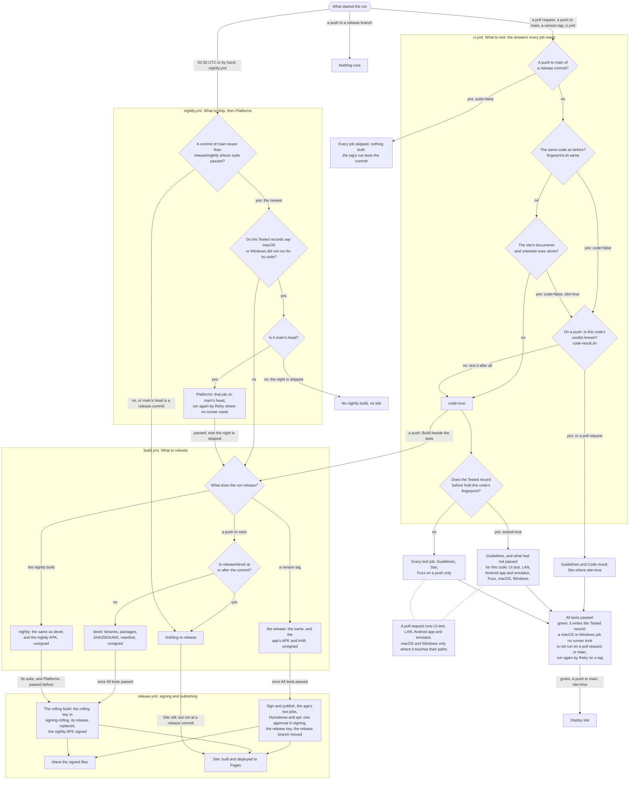

# Massimo — CI Conventions (v1.72.0)

What CI does in this project, for whoever has to change it.
`/AGENTS.md` names this file as the canonical owner of CI conventions,
so a rule that lives only in a workflow YAML — a version pin,
an ordering constraint, a reason a step exists — belongs here as well,
in words.
The pipeline is the source of truth for *what* runs;
this document is the source of truth for *why*.

## Contents

<!-- BEGIN GENERATED CONTENTS - do not edit; run "GUIDELINES/shared/tools/sync-docs.sh" -->
1. Where CI Is Defined
2. What Runs, and When
3. The Commands Are the Project's Commands
4. Guideline Gates
5. Secrets and Variables
6. Releases
7. Runner Constraints
8. Dependabot and the Repository's Settings
9. Document Governance
<!-- END GENERATED CONTENTS -->

## 1. Where CI Is Defined

| Platform | Files |
|----------|-------|
| GitHub Actions | `.github/workflows/ci.yml` (a push to `main` or of a version tag, a pull request), `.github/workflows/build.yml` (the release's build, called by ci.yml beside its tests and by nightly.yml), `.github/workflows/release.yml` (signing and publishing, called by ci.yml once its tests have passed and the build is done, and by nightly.yml), `.github/workflows/nightly.yml` (the nightly build, daily at 02:30 UTC and by hand on `main`), `.github/workflows/platforms.yml` (the Windows service and macOS LaunchDaemon jobs, called by ci.yml beside its tests and by nightly.yml before its build), `.github/workflows/retry.yml` (a macOS or Windows job no runner took, run again in a tag's run of ci.yml and in a nightly run, once that run has ended), `.github/workflows/publish.yml` (called by release.yml, or run by hand for a tag), `.github/workflows/caches.yml` (CodeQL's overlay databases of older commits deleted from the Actions caches, every hour) |

There is no other platform.

## 2. What Runs, and When

How a run decides what it does, in the order it decides;
the table and the paragraphs below give each step's reasons.

| Trigger | Jobs |
|---------|------|
| push to `main`, pull request (each push to its branch) | Vet and test (gofmt, go vet per platform, go test with `-count=1`, its skipped tests and its slowest tests and packages named in the summary, the three tests that need root once more as root, the store's benchmarks once each with `-short`, `make cross`); actionlint (`make actionlint`: the workflows by actionlint, their `run:` scripts by the runner's shellcheck); UI types (`make ui-check`: `tsc --noEmit` over the web UI's parts, `internal/server/ui/src/`, then Biome's two hooks rules over them); Race (`make race`, the race detector on `internal/server`, `internal/store`, `internal/cubelan`, `internal/proxy`, `internal/serve`, `internal/announce`, `internal/notify`, `internal/engine`, `internal/cubeio` and `internal/certs`, `-count=1` and `-timeout 30m`, `checkptr` off for the packages under `modernc.org` alone, its skipped and its slowest tests named in the summary); Test (armv6, QEMU) (`make test-armv6`, every package's tests with `-short`, `-count=1` and `-timeout 30m` on 32-bit ARM, run by Ubuntu's `qemu-user` as the Raspberry Pi 1's core, its skipped and its slowest tests named in the summary); Fuzz on a push to `main` only (`make fuzz`, every fuzz target for 10 s, a crash's input kept as the artifact `fuzz-crash`, Go 1.26's own deadline passed with a warning); govulncheck for linux and windows; Debian package (`make packages`, then the amd64 one installed, checked and purged in a trixie and a bookworm container, then under systemd, each case in a container of its own (`make deb-systemd-test`: the first start, the restart, the upgrade from v0.12.0-alpha.1 with the service running), and installed again from an apt repository built with a throwaway key; the packages uploaded as the artifact `packages`); Platforms (platforms.yml, which nightly.yml calls too, its jobs "Platforms / Windows service" and "Platforms / macOS LaunchDaemon"): Windows service (the unit tests of the update, the installer, the command line, the start's guard among them, discovery, `internal/safefile` and the settings file's parser, `internal/env`; install, run, update from the API and by hand, roll back, remove, on a Windows runner; then a second `serve` announcing itself beside Windows' own mDNS, found by `massimo discover`; on a pull request only when it changes the job's own paths or the announcement's, as the job What to test answers, and not on the merge of a pull request that found it not needed); macOS LaunchDaemon (the unit tests of the update, the installer, the command line and `internal/safefile`; first `install` on the template's settings, `packaging/launchd/template-test.sh`: the message and its owner line run as printed, a loaded job restarted, a booted-out one left stopped, the web UI's way, the purge; then the same as Windows on a macOS runner, with a self-signed certificate: the service installed with `-tls self-signed`, the health check and the API over `https://`; then the Homebrew formula rendered for a tarball of the checkout, built from source, tested and checked for the marker; then a second `serve` beside Apple's mDNSResponder, found and resolved by `dns-sd`; on a pull request as the Windows job, with its own paths); UI test (the web UI's pytest suite, a job per case, "UI test (1100-en)", "UI test (1100-de)", "UI test (390-en)" and "UI test (390-de)", each its case in four workers, its log naming the 20 slowest phases of the tests; on failure the failed tests' screenshots, and the screenshots, videos and traces of their run once more, as `ui-test-results-<case>`; and "UI test (screenshots)", the screenshot set in a job of its own, uploaded as the artifact `ui-screenshots`, the PNGs only; on a pull request only when it changes the UI, its bundler (`tools/uibundle`), the vendored Preact, the server's own Go files but for its tests, the OpenAPI file, its suite or `ci.yml`, as the job What to test answers); LAN against avahi (`make lan-test`: a second `serve`'s searches finding a fake Cube, losing it with its cable pulled and finding it again, then from a box's proxy too; `serve` beside avahi-daemon, `avahi-browse` and `massimo discover` on a client; a third `serve` following the Cube by its serial to another address after the loss; in Docker; on a pull request only when it changes the announcement, discovery, the shared port, the server's own files, the proxy, the Go module, the LAN test or `ci.yml`, as the job What to test answers, and not on the merge of a pull request that found it not needed); Android app (`app/version.json` against its tag, the debug build with its unit tests and lint, the release APK built at two paths and compared byte for byte, then the AAB and the nightly APK signed with a key made for the run; on a pull request only when it changes `app/`, the web UI's files the app bundles, `packaging/app-*.sh`, `tools/app-emulator/`, `ci.yml`, `build.yml` or `release.yml`, as the job What to test answers, and not on the merge of a pull request that found it not needed); Android emulator (`make app-emulator-test`: the app's instrumented tests on an emulator of the pinned image, KVM given to the runner's user, against two servers on the runner with the fake Cube, the fingerprint simulated, in a step with a time limit of its own, strict: a test skipped or fewer run than the sources declare fail it; its results, the emulator's log, the device's, the servers', the screens of failed tests and Gradle's report and JUnit results, as the artifact `app-emulator-results`, on a failure or a cancellation, and kept seven days on a pass; where Android app runs, its result counted with Android app's under the Tested record's `app=`); Guidelines (section 4); Site (`packaging/site/build.sh --no-apt`: the site's pages and the docs of the commit, every link checked, a document under `docs/` missing from `docs/fragments/_documents.md` failing it; never deployed; also for a change to the site's documents alone); Code result, for a change to documents alone only (`packaging/code-result.sh`: the verdict of the last run that tested the code, below) |
| beside the jobs above, on a push | Build (build.yml): What to release decides what the run releases, then every target built without cgo with the Debian packages, the build record, `SHA256SUMS` and the manifest, the provenance attested; for a version tag the Android app's APK and AAB, for the nightly build its nightly APK, unsigned, attested too; nothing signed (section 6) |
| after every job above | All tests passed: fails unless none of them failed or was cancelled, but for a macOS or Windows job no runner took on a pull request or a push to `main`, which counts as not run, and names each with its result in its summary, an annotation for each that did not pass, and on a pull request in one comment; a job that passed only on a re-run counts, and is named in a line of the summary, a warning, that comment and, on a pull request, a comment of its own; then, on a push, once Build is done, Release (release.yml): a push to `main` becomes the `devel` build, the GitHub release `release/devel` replaced in place, signed with the rolling key (section 6); then, at every run of release.yml, Site (site.yml): the site built with the newest release's signed apt index and the docs of every channel, and deployed to GitHub Pages; nothing where no release carries the index yet; for a push to `main` of the site's documents alone, which has no Build and so no Release, Deploy site (site.yml) instead |
| push to a release branch (`release/alpha`, later `release/beta` and `release/stable`) | nothing: ci.yml listens to `main` and the tags; the release moved the branch to a commit ci.yml had tested |
| a version tag | every job above, as for a push to `main`, Build included, a macOS or Windows job no runner took failing it, which Retry runs again; then release.yml: sign the manifest and `SHA256SUMS` with the release key, verify the signatures against the public key compiled into `massimo`, publish the GitHub release; with the app's keys set, sign the Android app, add it to the release and its lines to `SHA256SUMS`, sign that again and attest the signed files (section 6); then, with the deploy key set, the Homebrew formula of the release's channel rendered and pushed to the tap (publish.yml, section 6), and, with the apt key set, the apt repository rebuilt from the releases and deployed to GitHub Pages |
| daily at 02:30 UTC, or by hand (`gh workflow run nightly.yml --ref main`) | nightly.yml: What to ship (`packaging/nightly-pick.sh`) picks the newest commit of `main` whose suite passed and that is newer than the one the nightly build carries, and Platforms runs the macOS or Windows job first, on `main`'s head, where the Tested records say the job did not run for its code, the night skipped where that commit is not `main`'s head; once Platforms passed or was not needed (Platforms passed), build.yml, then release.yml: the nightly build, `release/nightly`; nothing where there is no such commit, and nothing, the site included, where Platforms did not pass (section 6). By hand, `dry_run` ships nothing and `platforms` runs both jobs on `main`'s head |
| a tag's run of ci.yml or a nightly run that ended failed | retry.yml: where a macOS or Windows job no runner took is all that failed, the run's failed jobs and those after them run again, about 20 minutes later, at most twice (`packaging/ci-retry.sh`; below) |
| by hand (`gh workflow run publish.yml -f tag=<tag>`) | publish.yml: the formula of a release already out, such as the one published before the tap existed |
| every hour at :23, or by hand (`gh workflow run caches.yml`, `-f dry_run=true` to delete nothing) | caches.yml: CodeQL's overlay databases of all but the three newest commits of `main` deleted from the Actions caches, for each language (`packaging/cache-prune.sh`; section 3) |

Each commit runs the workflow once:
a push to a pull request's branch runs it as the pull request's,
not a second time as a push,
and the commits `main` receives run it as pushes to `main`.
A release commit runs the suite once, as its tag's:
its push to `main` runs What to test alone (below).
The release waits for the whole suite of the tag's run,
and runs with the tag as its ref,
which is why ci.yml calls release.yml (`workflow_call`)
rather than release.yml listening for ci.yml's end (`workflow_run`):
such a run carries the default branch,
which the `signing` environment does not admit.
The release branches receive only commits already on `main`,
so a push to one runs nothing.
The release is built beside the test jobs (build.yml, ci.yml's Build),
not after them:
the build holds no secret, and nothing is signed until All tests passed,
which Release waits for with the build;
a build whose tests fail is thrown away with the run.
That saves the build's four and a half minutes,
which used to follow the six of the UI suite's job,
the longest test job then (owner, 2026-11-10, AP ParallelBuild).
build.yml's What to release therefore decides at the start of the run;
`rolling` checks the release's commit again just before publishing.
A job after one that can be skipped names a status function in its `if:`:
GitHub otherwise adds `success()`,
which is false while any job up the chain was skipped, not only its own `needs`.
Fuzz is skipped on every pull request, and every job on a release commit's push,
so the test jobs, All tests passed and Release
(`!cancelled() && … && needs.tests.result == 'success'`) name one;
without it the first `devel` build, on 2026-11-10, was skipped.
Every test job waits for What to test, the gate that opens ci.yml:
on a push to `main` of a release commit,
whose summary opens with `chore(release): `,
it answers `suite=false`,
and every job is skipped, All tests passed and Release too.
`make release <flavour>` pushes `main` and the tag atomically,
and `main` must equal `origin/main` before,
so the tag's run tests that very commit;
running the suite on `main` as well tested it twice
and made a `devel` build under the release's own version (owner, 2026-11-10,
as file_checksum_search keeps one run per release).
The nightly build still finds the commit, through its tag's run.
A change to documents no test reads answers `code=false`:
every job but Guidelines is skipped, All tests passed passes,
and `main` makes no devel build,
its binaries being those of the commit before (owner, 2026-11-11, AP DocOnly).
Those documents are `GUIDELINES/wip/**`, `GUIDELINES/project/**`,
the generated `AGENTS.md` and `GUIDELINES/README.md`,
`CHANGELOG.md`, `CHANGELOG.d/**` and `LICENSE`,
declared as `[ci] untested` in `GUIDELINES/config.ini` and rendered into the contract;
`GUIDELINES/shared/tools/fingerprint.sh` refuses a list that names a shipped path
or config.ini itself.
What to test asks it whether the code is the same:
`fingerprint.sh same` of a pull request's base and its merge commit,
or of the commit `main` was at (`github.event.before`) and the one pushed;
a tag is always tested whole,
and the tool's exit 2, an unknown commit included, counts as code.
A release commit is recognised by its role,
as `commit_title.py` reads the summary,
so that `chore(release:<component>)` is one too.

A green run is carried to later commits with the same code (owner, 2026-11-11,
AP TestedTree).
All tests passed, once it has, writes a commit status, context `Tested`,
on the commit the run tested:
a pull request's head, or the commit pushed to `main`.
It holds `fingerprint.sh fingerprint` of the tree that ran,
a pull request's merge commit in its run,
and whether the UI tests, LAN, Fuzz, the Android app, macOS and Windows
passed for that code (`fp1:<hex> ui=… lan=… fuzz=… app=… mac=… win=…`);
LAN is `unneeded` where What to test answered `lan=false`, a pull request's
filter finding it not needed, and it did not pass,
and so is the Android app where it answered `app=false` (AP MobileApp, D17-A),
and so are macOS and Windows, where it answered `macos=false` or `windows=false`
(AP TestSpeed, D1-A, D2-A).
The Android app passed where both its jobs did, Android app and Android emulator
(AP MobileApp, Block 18), the record having no room for a word of its own.
GitHub takes 140 characters for a status's description,
and the record fills them at its longest:
the fingerprint's 68 and the six words' 72,
`ui=false lan=unneeded fuzz=false app=unneeded mac=unneeded win=unneeded`,
which is why macOS and Windows are `mac` and `win` there;
a longer record leaves a warning in the step, which fails nothing,
and a new word needs room made first.
What to test reads the status on the commit the run before tested:
for a pull request its head's first parent,
for a merge into `main` its second parent, the pull request's head.
Where it is green, written by `github-actions[bot]` and its fingerprint the commit's own,
it answers `tested=true`:
the jobs that passed for that code are skipped,
Fuzz, which a pull request never runs,
and the UI tests, LAN, the Android app,
macOS and Windows run where they had not passed,
but for the last four on a push where the record says `unneeded` (owner,
2026-11-15, AP SiteOnly, D78-C; AP TestSpeed, D1-A),
and Guidelines, All tests passed, Build and Release run as always;
the run's own Tested status then carries the record on.
So a branch's retirement after its green run tests nothing again,
nor does its merge into `main`, where `main` moved by documents alone meanwhile;
where `main` moved by code, the merge's fingerprint is new and everything runs.
A fork's pull request has a read-only token and writes no status,
and the step's failure fails nothing.
The same code is not the same environment: a Go patch or a runner image
can change in between, as between two runs of one commit,
and a flaky test that passed is not retried.
A job that failed and passed on a re-run counts as passed here too,
as in Code result's verdict, and leaves a record instead (owner,
2026-11-18, AP TestInfrastructure, D10-A; All tests passed, below).
Other paths stay out of the list because something tests them:
`docs/**`, `README.md` and `CONTRIBUTING.md` (below),
`GUIDELINES/shared` (Site renders with its `md_html.py`,
the rolling notes use its `changelog.sh`),
`.gitattributes` and `.gitignore` (line endings, what `make` counts as dirty),
and `tools/**`.
The Guidelines job runs `tools/identifiers` itself,
since that check reads the project's documents and changelog too.

A change to the site's documents alone answers `site=true`, and `code=false`
with it (owner, 2026-11-13, AP SiteOnly):
Guidelines and Site run, every other job is skipped,
and a push to `main` makes no devel build but deploys the site,
through Deploy site, once All tests passed has succeeded.
Those documents are `docs/**`, `README.md` and `CONTRIBUTING.md`,
and, since 2026-11-13 (owner, D66-A and D67-A),
the site's own pages in `packaging/site/`, named one by one:
`site.py`, `doc.html.in`, `docs.js`, `site.css` and `privacy.html`,
declared as `[ci] site` in `GUIDELINES/config.ini`,
a key of the project's own that no shared tool reads.
The five pages are excluded from `project.shipped` too,
so a change to them alone owes no CHANGELOG bullet.
`build.sh` and `index.html` stay code, and shipped:
the Debian package job's apt test (`packaging/apt/test.sh`)
builds the site from them with the apt repository,
which no other test does before the deploy;
it copies `site.css` and `privacy.html` as they are, whatever they hold,
and never builds the docs.
A new file under `packaging/site/` is code until it is listed.
Only the Guidelines job and Site read them:
Guidelines with `tools/identifiers` and the guidelines' check of README's
generated parts against `docs/fragments/`,
Site by building the docs and checking every link.
One Go test reads one of them too,
`TestOpenAPICoversRoutes` the file `docs/api-v1-openapi.yaml`,
which is in the list all the same (D64-C):
a change to a route changes Go, and runs the test.
A change to the OpenAPI file alone that breaks it passes,
and fails the next run with code instead, which then fixes it.
What to test answers `site` where the code differs from the base,
the one `fingerprint.sh same` compared,
`git diff --quiet <base> HEAD` finds nothing outside the two lists,
and `fingerprint.sh shipped` finds no shipped path among the changes.
An unknown base fails `git diff` and counts as code,
and so does a list value that opens with `:`,
since the gate puts `:!` in front of each.
Deploy site calls `site.yml` as release.yml's Site does for every other push,
in the same `pages` concurrency group.
A change to documents alone tests no code,
and its code is that of the commit before it:
tested there, but not always passed.
So that All tests passed does not stand for code that failed,
which the nightly build would take (owner, 2026-11-14, AP SiteOnly, D68-C),
the job Code result runs where What to test answers `code=false`,
and only there, among All tests passed's needs.
It runs nothing again, since a known result is known (D70-B):
`packaging/code-result.sh` walks `main`'s first parents from `HEAD^1`
while a commit holds the same code,
no path differing but those of `[ci] untested` and `[ci] site`,
and reads ci.yml's push runs on each, a tag's among them,
the latest attempt of each, so that a failed job re-run green counts.
A run's code jobs are all but What to test, Guidelines, Site, Code result,
All tests passed, Deploy site and the called Build and Release.
A run still going is waited for, up to an hour (D74-A).
No verdict comes from a cancelled run,
one in which Code result ran (a verdict carried),
and one that ran no code job:
a release commit's push runs nothing, and its tag's run on the same commit
holds the verdict.
A code job that failed, timed out or was cancelled is red, that run named;
otherwise the code passed.
Where no run on a commit gives a verdict and none carried one,
its record does, read where What to test reads it:
the Tested status on the commit, then on a merge's second parent,
the pull request's head;
green and opening with `HEAD`'s fingerprint, the code passed.
`main`'s group keeps one run going and one waiting,
so a push replaces the waiting run before it, which never starts;
the merge it would have tested had passed as its pull request (owner,
2026-11-15, D76-A, D77-A).
Otherwise the walk goes on.
Where the walk reaches a commit with other code, 100 commits
or the end of the history first, no run tested this code, which is red.
On a push, What to test asks that first (owner, 2026-11-15, D81-A):
`CODE_CHECK=1 packaging/code-result.sh` waits for nothing and answers
whether a verdict, of either colour, is known or a run is still going.
Where none is, as after a merge whose run was replaced while it waited and
whose pull request was tested on another base,
it answers `code=true`, and the run tests the code;
so on a push Code result's red is a run that failed.
A pull request is not asked: it adds no code, and its history is shallow.
Red fails Code result on a push, and so All tests passed,
which keeps the nightly build and Deploy site away,
until a change to the code passes or the failed run is re-run green;
on a pull request it is a warning and fails nothing,
since the pull request adds no code of its own (D73-A).
What to test writes its answers into the run's summary as a table
(owner, 2026-11-15),
each with what it means for the run, below the reasons it gave,
such as the documents alone since a commit or the record it found.
Only an answer of `false` skips a job:
a gate that fails leaves its answers empty, so every job runs,
and All tests passed fails on the gate's result.
The ruleset on `main` requires All tests passed and Guidelines alone,
since 2026-11-11 (owner, D54-A):
a matrix job skipped as a whole reports once, under its unexpanded name
(`govulncheck (${{ matrix.goos }})`),
so a required `govulncheck (linux)` waited forever on pull request #177;
All tests passed counts every job, a skipped one as passed,
and a new job needs only to be among its `needs`.
All tests passed says which job did not pass, and how (owner,
2026-11-14, D1-B, D2-A, D3-A),
since `needs` alone gives results without names
and a job no runner took reads as cancelled:
macOS LaunchDaemon on pull request #225, twice, with no step run.
Its first step reads the run's jobs through the API (`actions: read`),
by display name, matrix jobs expanded,
"cancelled before a runner took it" for a cancelled job with no runner and no step;
it lists them in the job's summary, those that did not pass first,
with an error annotation for each,
and falls back to the `needs`' ids where the API tells nothing.
It leaves out All tests passed itself and the jobs of the workflows the run calls,
Build, Release and Deploy site, which are not among its `needs`:
the API knows a job by its name, not by its id,
so the step names them, and a new job calling a workflow is added there
where it is not among the `needs`; Platforms' jobs are kept, as Platforms is.
On a pull request, a macOS or Windows job that no runner took counts as not run (owner,
2026-11-18, AP TestSpeed, D5-A):
GitHub's macOS runners are few,
and a job that waited for one ended cancelled with no runner and no step
on pull request #225 twice and again on 2026-11-17,
holding a pull request whose code it had nothing to say about.
A push to `main` counts it as not run too (owner, 2026-11-18, D16-A, the owner's split):
of six runs on 2026-11-17 and 2026-11-18 whose macOS job no runner took,
four were pushes to `main`,
where it failed All tests passed, and so the devel and nightly builds,
until the job was re-run.
GitHub gave up on each after about a quarter of an hour in the queue.
The two jobs run in a workflow of their own, platforms.yml (D15-B),
which ci.yml's job Platforms calls,
so the API names them "Platforms / Windows service" and "Platforms / macOS LaunchDaemon",
and the `needs` know only Platforms, with the two jobs' results together.
ci.yml gives those two names with their caller's id
(`UNRUN_JOBS`, in the workflow's `env`);
one of them that the API gives as "cancelled before a runner took it",
its conclusion `cancelled` with no runner and no step,
is named in the summary as "not run, as no runner took it",
with a warning and in the pull request's report where there is one,
and its caller's id is the step's output `unrun`,
where every job of `UNRUN_JOBS` with that id passed, was skipped or was not taken either,
and the id's result among the `needs` is `abandoned`, `cancelled` or `failure`.
From the second attempt on, the job's runs in the earlier attempts count too:
where its last run that a runner took failed, it fails,
so that a re-run no runner took does not hide a failure,
and so does every such job where the earlier attempts could not be read.
`needs` said `abandoned` for every such job of ci.yml's own that was looked at,
in runs 44125840544, 44148743439, 44150911350, 44151208458 and 44335801523;
what GitHub gives a called workflow's caller for it is not known,
and a caller's result is that of its jobs together,
so the three are let through where the API shows nothing else in the call.
The verdict counts an abandoned, cancelled or failed caller named there as passed,
on a pull request and a push to `main` alone;
the Tested record then says `mac=false` or `win=false`, as the job did not pass
(`packaging/tested-record.sh`, from Platforms' outputs `macos` and `windows`,
each true where its job passed).
On a pull request the push of the merged tree, reading the record, runs the job,
and a failure there shows on `main`,
where GitHub's failure email reaches whoever pushed;
on `main` the devel build goes on,
and the nightly build runs the job before it ships the code (D15-B, section 6).
A job cancelled once a runner had taken it fails on both,
and so does every such caller where the step did not run or read no jobs,
since only its output lets one through.
The pull request's next run with the same code runs the job again,
where its paths ask for it, as the record does not say it passed.
Code result takes such a job for no verdict on the code
(`packaging/code-result.sh`, from the same `UNRUN_JOBS`),
so that a change to documents after such a push is not red for it;
it reads every attempt's jobs,
and a failure in an earlier attempt that no runner's later run passed is red.
A tag is not spared: its release needs both jobs,
and a job no runner took fails All tests passed there, in its first attempt as before.
Retry (`retry.yml`, `packaging/ci-retry.sh`; D16-A) follows a tag's run of ci.yml
and a nightly run to their end (`workflow_run`),
as a run cannot re-run itself while it runs:
where every job of the run's first attempt passed or was skipped,
but for jobs of "Platforms / …" that no runner took and the verdict job,
All tests passed or nightly.yml's Platforms passed, which failed for them,
it waits 20 minutes and asks GitHub to re-run the run's failed jobs
(`rerun-failed-jobs`, `actions: write`, its only permission beside reading the script),
which runs them and every job after them, the release among them, in a new attempt;
it then waits for the jobs it re-ran to end,
and where one was again not taken, for the attempt to end, and does it once more.
It acts on a run's first attempt alone and makes both re-runs from that one job,
so whatever GitHub does with the attempts it starts there are two re-runs at most;
after them, without a runner, it fails with an error, and so does the run:
the tag's release fails, or the night is skipped.
It leaves the run alone where anything else failed or was cancelled,
where the verdict did not fail (as in a run someone cancelled),
and where the run is at another attempt (someone ran it again);
a re-run that leaves out a job it was to take fails with an error naming it,
as GitHub's documentation names failed jobs alone and a job no runner took is cancelled.
The summary of a tag's All tests passed says Retry will run such a job again;
the re-run attempt's names it as passed only on a re-run (below).
It runs from `main`'s copy of the workflow and the script,
checks out no code of the run, holds no secret,
and passes the event's values through `env` alone.
A pull request can add a workflow of any name, or change one,
so neither the condition nor the script goes by a workflow's name:
both take a run of this repository whose head is this repository's too,
by its workflow's path and its event,
ci.yml's push of a tag, or nightly.yml's schedule or start by hand on `main`;
the script reads that from the run, which must be the event's branch and commit,
at the start and again before each re-run,
checks that the tag is a version tag (`vX.Y.Z`, `vX.Y.Z-<label>`)
at the run's commit and no branch's name,
and refuses any other run with an error,
as it does a run it cannot read after its wait, three tries apart.
Each wait for an attempt ends within an hour (`RETRY_DEADLINE`),
so that both waits and both attempts end within the job's three hours.
On a pull request it keeps one comment (`pull-requests: write`),
starting with `<!-- ci-report -->`:
written at the pull request's first failing run,
then edited by every run, a passing one included,
so a pull request that never fails gets none.
A push to `main` and a tag get the summary and annotations alone;
GitHub's failure email reaches whoever pushed.
A job that failed and passed on a re-run counts as passed, and is named (owner,
2026-11-18, AP TestInfrastructure, D10-A).
A re-run is an attempt of the same run (`github.run_attempt`);
from the second on,
the step reads the jobs of every attempt (`jobs?filter=all`),
and a job whose latest run passed and an earlier one did not
gets a line of the summary with the attempts it did not pass in and the one it passed in,
a warning annotation, and a table in the pull request's report.
An edit of that comment notifies no one, and the owner wants the author told,
so a job whose last run before this attempt did not pass,
which this attempt's re-run then made pass,
gets a comment of its own, starting with `<!-- ci-rerun -->`:
one at each re-run that made a job pass,
and none at a later attempt of a run that had passed already.
A job a re-run leaves alone is carried into the next attempt with its start,
by which a failure carried so counts once.
A push to `main` gets the summary and the warnings alone.
The step is `packaging/ci-report.sh`, its test `packaging/ci_scripts_test.go`
with the API's answers made up and a stand-in for `gh`;
the job checks out that one file for it, which takes `contents: read`,
and a checkout that fails leaves the report undone and fails nothing.
The step fails nothing (`continue-on-error`):
the verdict is the next step's, from `needs`,
and a read-only token, Dependabot's or a fork's,
leaves a warning instead of the comment, in the summary too.
A pipe into `grep` in a step reads to the end (`grep … >/dev/null`,
not `grep -q`):
under `pipefail` a `grep -q` that exits at its match kills a writer still writing,
which failed the macOS job with exit code 141 on 2026-11-10
(`massimo tls show | grep -q`).
Runs share a concurrency group per ref:
a new push to a pull request cancels the run it supersedes,
while a run of `main` is never cancelled,
so every commit of `main` keeps its result.

Every job that runs on a runner has a time limit (`timeout-minutes`;
AP TestInfrastructure, Block 9), since GitHub's own is six hours:
about three times its longest run among the 57 runs before 2026-11-18,
ten minutes at least, and above the Go tests' own `-timeout`,
so that Go's timeout fails a hung test with its goroutines in the log
before the job is cut off.
In minutes, the limit and the longest run:
What to test, actionlint, UI types, Guidelines, Site and All tests passed:
10, under 1;
LAN against avahi 15, 4.8; govulncheck 15, 3.5;
Fuzz 20, 4.5; the Debian packages 20, 5.6; Windows service 20, 3.4;
Vet and test 30, 7.6, its `go test` with Go's ten minutes a package;
macOS LaunchDaemon 30, 8.1;
Race 40, 9.6, and Test (armv6, QEMU) 40, 10.3, both above their `-timeout 30m`;
the UI test jobs a case's 30 and the screenshot set's 15,
estimated from the two-case jobs' 15.4 before AP TestSpeed's Block 5
until they have runs of their own;
the Android app keeps its 45, 7.0, and Code result its 70,
which waits up to an hour for a run still going;
the Android emulator 45, about three times the 15 or so it is estimated
to take, until it has runs of its own,
its suite's step 32 of them (below).

The armhf package ships the armv6 binary, which `make cross` only builds:
Test (armv6, QEMU) runs every package's tests on it,
as `qemu-arm -cpu arm1176` (the Raspberry Pi 1's core) runs each test binary,
without binfmt and without a new action, Ubuntu's `qemu-user` from apt.
`-short` keeps the emulation to a few minutes:
`internal/server` takes the longest, about two minutes on a PC.
In CI it took 245 to 367 s in six runs, up to 61 % of Go's default ten minutes,
and in QEMU with four CPUs under load its tests added up to about 21,
so `make test-armv6` gives a package 30 (owner, 2026-11-17,
AP TestInfrastructure, D14-A).
The emulation's slowness brings out tests that rely on timing,
as it did the store's prune racing a test's fill;
such a test is fixed, not skipped under QEMU.

The web UI smoke test (`make ui-test`) and the screenshot set
(`make ui-screenshots`) run in the UI test jobs,
on the Chromium of Microsoft's Playwright image (section 3).
The slideshow (`tools/ui-test/slideshow.sh`) is built where the set is taken
and committed with it, not in CI,
which would need ImageMagick from apt.
The UI changes are still verified with the smoke test on the developer's
machine before a pull request (the contract's test gate),
and the set committed under `docs/screenshots/` is the one taken there:
the runner's fonts give other pixels,
so the artifact is for looking at,
and nothing compares it with the committed set.

The UI suite's 1504 runs (376 tests on 2026-11-19,
each at 1100 and 390 px, in English and German)
run in four jobs, one per case
(`UI_TEST_CASES`, `tools/ui-test/README.md`;
owner, 2026-11-18, AP TestSpeed, D7-A),
each in four pytest-xdist workers, one per CPU of the runner,
each worker against a server set of its own.
The four cases took 11 minutes of a 13-minute run in one job (AP UiMatrix),
and in two jobs the 1100 px one, its two cases and the screenshot set,
12.6 minutes on 2026-11-18, every run's longest job.
So each case has a job and a runner of its own,
and the screenshot set, about a minute after the 1100 px suite before,
a fifth job beside them, "UI test (screenshots)":
a run's UI tests take as long as its slowest case,
at the cost of three jobs more a run against GitHub's 20 at a time,
each paying for its container and its build.
The five jobs keep the id `screenshots`,
which All tests passed needs as one: passed where all five passed,
and the Tested record's `ui=` with it.
The first pass records no Playwright trace,
whose DOM snapshots made every step slower,
and no video,
which took a quarter of a second of every test's set-up and tear-down,
13 % of a case (D8-A);
the failed tests run once more with both.
The parts guard runs in two of the four cases (`docs/ui-testing.md`, section 8),
and in the other two its tests are deselected at collection
rather than each loading a page to be skipped (D9-A),
so that the 1100-de and 390-en jobs report only the suite's real skips.
A pull request runs the jobs only when it changes `internal/server/ui/`,
`tools/ui-test/`, `tools/uibundle/`, `third_party/preact/`,
the server's own Go files (`internal/server/*.go`)
but for its tests (`internal/server/*_test.go`),
`docs/api-v1-openapi.yaml` or `.github/workflows/ci.yml`:
the paths the contract asks `make ui-test` for, the page's bundler and Preact,
the server the page talks to and the API it reads,
whose change showed on `main` alone before (AP TestInfrastructure, Block 9),
and the jobs' own definition;
a server test is not in the binary under test,
and Vet and test and Race run it (D9-A;
`TestCIUIGateLeavesOutServerTests`, `packaging/ci_scripts_test.go`);
the OpenAPI file counts beside code only,
since alone it is a site document (section 2, `site=true`).
The jobs then run all four cases,
so that a case it would have left out does not fail first on `main`.
The job What to test answers that from the pull request's merge commit,
whose first parent is the base branch.
The condition sits on the job, not on the workflow's trigger:
All tests passed, the check `main` requires,
counts a job skipped by its `if:` as passed,
while a workflow that a path filter never starts would leave it waiting.
Only an answer of `false` skips the jobs,
so a What to test job that fails runs them rather than letting the pull request
through untested.
A push to `main` runs the job whatever it changes,
so a change elsewhere that breaks the page shows on the merge commit's run.

The LAN job runs `make lan-test` (`tools/lan-test/README.md`):
five hosts in Docker on a bridge network of their own,
a fake Cube with a MAC of eQ-3's prefix,
a searcher, a second `serve` with no Cube that searches through its API,
a box running `serve` beside avahi-daemon, and a client with avahi of its own.
With no proxy on the LAN, the searcher must find the Cube,
lose it at the first search with the Cube's cable pulled (its link down),
and find it again with the cable back;
then, with the box up, list the Cube's serial from the Cube and from the proxy.
It is discovery's only test with each host at an address of its own,
on the real ports;
the Go tests ask a fake Cube on the loopback.
Then `serve` must share UDP 5353 with avahi,
`avahi-browse` resolve it on both hosts,
`massimo discover` list it and mark the proxy but not the Cube,
and its goodbye take it out of the client's avahi.
Last, a follower, a third `serve` with the Cube by its serial alone,
must follow the Cube to another address on the bridge,
searching at the loss with `-discover-interval 0`.
It is the announcement's only test against another implementation on Linux;
the macOS and Windows jobs add Apple's mDNSResponder and Windows' mDNS,
with a second `serve` on every address in a step of their own,
the macOS one as a launchd daemon (section 7).
A pull request runs the job only when it changes the announcement's paths (below),
`internal/proxy/`, `internal/cubelan/`, a file directly in `internal/server/`,
`cmd/massimo/discover.go`, `tools/lan-test/` or `.github/workflows/ci.yml`,
as the job What to test answers, and a push to `main` always,
as the UI test jobs do,
but for the merge of a pull request that found it not needed for the same code
(section 2, `lan=unneeded`; D78-C).
The announcement and discovery share their UDP ports through `internal/sharedport/`,
and the Go module pins `golang.org/x/net`, whose multicast the announcement uses (owner,
2026-11-15, D79-A);
a change the list misses never runs the job,
since nothing runs it on `main` then.
The server's own files are among them because discovery's runs are decided there
(`discovery.go`, and `server.go` waking a search at a Cube's loss),
which the follower's step checks;
`internal/server/ui/` is not,
since the LAN test never reaches the web UI (owner, 2026-11-15, D1-A).

The Windows service and macOS LaunchDaemon jobs are gated the same way (owner,
2026-11-18, AP TestSpeed, D1-A, D2-A, D3-A),
since the macOS job was often cancelled for want of a runner,
and both ran for any code that had not passed yet.
A pull request runs each only where it changes the announcement's paths or the job's own;
a push to `main` and a tag always,
but for the merge of a pull request that found the job not needed for the same code
(`mac=unneeded`, `win=unneeded`).
The announcement's paths are one list in What to test (D3-A),
which the LAN, macOS and Windows gates all read,
as each job tests the announcement beside another implementation,
avahi, Apple's mDNSResponder and Windows' mDNS:
`internal/announce/`, `internal/sharedport/`, `internal/serve/`,
which sets the announcement up, `cmd/massimo/serve.go`, its flags,
`go.mod` and `go.sum`, for `golang.org/x/net`.
The macOS job's own paths are those of its steps:
`internal/install/`, `internal/update/`, `internal/safefile/`,
the server's update route (`internal/server/update_api*.go`),
which the web UI's update goes through,
the command line's install, update, service, restart and reboot files
(`cmd/massimo/{install,update,service,restart,reboot}*.go`),
`serve_brew*.go`, `serve_packaged*.go`,
every Go file under `cmd/` and `internal/` named `_darwin` or `_other`,
the LaunchDaemons' plists and `template-test.sh` (`packaging/launchd/`),
the Homebrew formula (`packaging/homebrew/`),
`packaging/embed.go` and the settings template `packaging/env.template`,
which install writes,
`.github/workflows/ci.yml` and the jobs' own `.github/workflows/platforms.yml`,
and what sets the job up on its runner,
the UI bundle's action (`.github/actions/`) and its bundler (`tools/uibundle/`).
The Windows job's own paths are the same but for the darwin ones,
`_windows` in place of `_darwin`,
and add discovery, which its unit tests run:
`internal/cubelan/`,
the server's discovery, runtime and update files its `-run` covers
(`internal/server/{discovery,hostnets,runtimes,update_api,update_history}*.go`:
`runtimes.go` opens the shared discovery socket the proxy's responder answers on),
`internal/proxy/proxy.go`, the responder,
which binds a socket to each proxy's address beside that wildcard one,
as Windows binds otherwise than Linux (section 3),
and `cmd/massimo/discover.go`, which its mDNS step asks;
the rest of `internal/proxy/` is not, as the job runs none of its tests.
It adds the start's guard too, `cmd/massimo/startchecks*.go`
and `cmd/massimo/serve_stop_test.go`, which builds the `massimo.exe` it runs,
the other tests that run it there, the notes' and the reload's
(`cmd/massimo/{notes,reload}*.go`),
and the settings file's parser, `internal/env/`,
which Windows reads otherwise (section 3; AP StartConfiguration, D22-A, D23-A);
`TestCIGatesHoldTheWindowsTests` (`packaging/ci_scripts_test.go`) checks them.
Windows has no packaging of its own beyond `massimo install`.
A Go file named for another system (`_windows`, `_linux`, `_darwin`, `_unix`)
is not built on the platform and does not count for its job;
`_unix` is no file name Go knows,
and holds by the build tag each such file carries.
`TestCIGatesHoldPlatformFiles` (`packaging/ci_scripts_test.go`) runs the two gates
over every Go file under `cmd/` and `internal/` and asks `go/build`:
a file built for darwin or windows and not for linux must pass its job's gate,
since no Linux test builds it,
and a file a gate leaves out by its name must not be built for that platform.
`_other` files are let through on both, as most are built on one of the two,
`internal/cubelan/fakecube/listen_other.go` on both,
which `massimo fakecube` runs there.
The platforms' compile errors are caught on every pull request by Vet and test's
`GOOS=darwin` and `GOOS=windows` vet;
the lists are of the paths that hold the platforms' behaviour,
since `cmd/massimo` imports nearly everything,
and a gate on Go dependencies would run the jobs almost always.
A change the lists miss runs neither job until a later run takes it whole:
a push to `main` without such a record, or a tag.
A tag's run reads no record (it has no run before it) and filters no path,
so it runs both jobs, as every job, before any release on a channel.
The nightly build takes the newest commit of `main` whose run had All tests passed succeed,
so the commit it ships had the two jobs run where its change asked for them,
and where its pull request found them not needed, at the last change that did,
or no runner took one, which its record says;
nightly.yml then runs that job first, on `main`'s head,
and skips the night where the commit is older (section 6, D15-B).

The Android app job (AP MobileApp, Block 4) builds `app/android` with the
image's JDK 17 and Android SDK (platform 37.0, build-tools 36.0.0),
Gradle through the committed wrapper, nothing cached.
It checks `app/version.json` against its tag (`packaging/app-version.sh check`),
runs `:app:assembleFossDebug :app:testFossDebugUnitTest :app:lintFossDebug`
and `:app:lintNightlyDebug`,
then builds the release APK in the checkout and in a copy at another path
and compares the two byte for byte,
as F-Droid compares its build of a tag with ours;
on a difference both APKs are the artifact `app-repro`.
Last it builds the AAB and the nightly APK
and signs the three with a key made for the run (`packaging/app-sign.sh`),
which must match its certificate and must be refused against another one,
so that the release's signing path is proven before a tag needs it.
A pull request runs it only when it changes `app/`,
a file of `internal/server/ui/` the app bundles
(all but `index.html`, `partials/`, `src/`, `parts.js` and `vendor/`,
which `BundleUi` in `app/android/app/build.gradle.kts` leaves out),
`packaging/app-*.sh`, the emulator suite's `tools/app-emulator/`,
`ci.yml`, `build.yml` or `release.yml`;
a push to `main` always,
but for the merge of a pull request that found it not needed (`app=unneeded`),
as LAN (owner, 2026-11-17, D17-A).
Block 1 adds `make ui` and `make app-core-android` (Go, the NDK, gomobile)
before Gradle, here and in build.yml's job,
and `app/core/`, `internal/serve/` with what it imports,
`go.mod` and `go.sum` to the filter;
the comparison then covers the `.aar` too.

The Android emulator job (AP MobileApp, Block 18, D71-A) runs
`make app-emulator-test` (`tools/app-emulator/README.md`):
the app's instrumented tests on an emulator,
against two servers on the runner built from the tree with the fake Cube,
reached at `127.0.0.1` through `adb reverse`, as the phone rig reaches one,
the fingerprint simulated through the emulator's console.
GitHub's Linux runners have KVM, and a udev rule gives the runner's user
`/dev/kvm`, which the emulator needs for an x86_64 image.
The emulator and its system image are pinned in `tools/app-emulator/pins.sh`,
Android 14 with Google's APIs:
`tools/app-emulator/sdk.sh fetch` fetches the two archives into a directory
of the run's (`APP_EMU_SDK`), held to the size and the SHA-1 Google's SDK
repository gives, as sdkmanager checks them,
since sdkmanager installs the newest revision alone;
the runner image's SDK, its licences accepted, stays as it is.
The emulator boots without a window, audio or snapshots,
its data wiped, within `APP_EMU_BOOT_TIMEOUT` of the builds' end (420 s here).
An emulator in CI is known to stall at its boot or at a prompt,
so the suite's step has a time limit of its own, 32 minutes inside the job's 45:
GitHub counts a step's limit as a failure and a job's as a cancellation.
The step runs `make app-emulator-test`'s two steps,
`make ui` and `tools/app-emulator/run.sh`,
the script in the shell's place (`exec`),
since the runner signals the step's shell alone at its limit:
`run.sh` gets the signal, stops Gradle and takes the screens and Gradle's
report home before it stops the emulator,
within the seconds the runner gives before it kills what is left.
Gradle passes a run whose tests were skipped, an `assume` among them,
or that ran fewer than declared,
so `run.sh` counts what each of its two Gradle runs ran from the JUnit results
against the tests the sources declare (`tools/app-emulator/tally/`),
and in CI (`CI=true`) fails where one was skipped or not run.
Its results are the artifact `app-emulator-results`:
on a failure or a cancellation,
and on a pass too, kept seven days,
so that a passing run's count and logs can be read;
a case that is flaky is fixed or taken out, not retried in a loop.
It runs where Android app runs, What to test's `app` and `app_done`,
the suite's own `tools/app-emulator/` among the paths.
Its servers are built from the tree and the suite drives their page,
but a change to the server alone does not run it on a pull request,
the page's `index.html`, `partials/` and `src/` among it,
which the app does not bundle:
the push to `main` does, and a change to the page that breaks the suite
turns `main` red there.
Adding them to `app` would run both Android jobs at every pull request of the page,
the emulator's estimated 15 minutes and more beside the UI tests',
as `app` is one answer for both jobs.
All tests passed needs it, and the Tested record's `app=` is `true` only where
both jobs passed:
the record fills GitHub's 140 characters at its longest,
and a word of its own would need room made first (above).
What the phone check keeps is what an emulator cannot show:
a real fingerprint sensor, the phone maker's autofill, the look.

The actionlint job runs `make actionlint`,
the tool pinned by the `tool` line of `tools/actionlint/go.mod`,
a module of its own (section 8, `tools/actionlint/README.md`),
which `go tool -modfile=…` builds into setup-go's cache,
keyed by that module's `go.sum`.
actionlint checks the workflows' syntax, expressions and job graph,
and hands each `run:` script to the shellcheck it finds on the `PATH`,
the one of GitHub's Ubuntu image;
without one it checks the scripts by nothing,
so a machine without shellcheck passes what CI fails.
A finding that is wrong about the code carries
`# shellcheck disable=SC<n>` with its reason on the line above
(`GUIDELINES/shared/lang/shell/LINTING.md`).
The job runs where Vet and test runs and is among All tests passed's needs,
so the required check covers it (owner, 2026-11-12, AP ActionLint, D61-A).

Hardware is never touched by CI;
the Windows and macOS jobs run against the fake Cube.

## 3. The Commands Are the Project's Commands

CI runs the commands of the contract's facts table (`GUIDELINES/project/_CONTRACT.md`):
`gofmt -l .`, `go vet ./...` for linux, windows and darwin,
`go test ./...`, `make cross`, `make actionlint` and `make ui-check`.
`go test` includes `tools/identifiers`,
which fails on a serial, a MAC or a radio address in the tree that is not a
placeholder (the contract, "Secrets and identities").
Where CI differs, and why:

- Every job that compiles or tests Go, `build.yml`'s too,
  first runs one shared step, `.github/actions/ui-bundle`,
  right after `actions/setup-go`:
  the web UI's parts, `internal/server/ui/parts.js`,
  which the server embeds and git does not keep (AP UiParts, D172-A),
  so that without it the `go:embed` line of `internal/server/ui.go` stops the build.
  It runs `make ui`'s command written out, `go -C tools/uibundle run .`,
  because the UI test's image has no `make`,
  and the same on the Linux, Windows and macOS runners, under bash.
  The make targets a job runs after it build the bundle again,
  which leaves it as it is.
  The macOS job's Homebrew formula is built from `git archive`,
  which holds no bundle: the formula builds it itself
  (packaging/README.md, "Homebrew").
- UI types runs `make ui-check`, the type check and then the hooks lint,
  with the runner's Node.js and npm; no action installs them.
- `make race` is the contract's recommended `-race`, in a Race job of its own
  beside Vet and test, so that neither waits for the other:
  about 7 minutes in CI, up to 9.6 in November 2026, before Block 4 of AP TestSpeed,
  the server's and the store's packages taking the longest.
  It runs with `-count=1`, so that a pass in the cache is not taken for one,
  and `-timeout 30m`: under load `internal/server` took up to 988 s,
  past Go's default ten minutes (owner, 2026-11-17,
  AP TestInfrastructure, D14-A).
  Since 2026-11-18 it covers `internal/engine` (the command queue),
  `internal/cubeio` and `internal/certs` too, whose goroutines meet as well;
  five runs of their tests under `-race` found no race, in 13 s.
  It builds the packages under `modernc.org` with `-d=checkptr=0` (`RACEGCFLAGS`,
  AP TestSpeed, D6-A):
  `-race` turns `checkptr` on, and in SQLite, C translated to Go,
  checking its pointer steps was half the time of opening a fresh store,
  as many of the server's tests and most of the store's do;
  the race detector stays on in every package,
  and `checkptr` in the module's own and in every other dependency,
  as `docs/testing.md` says ("The race detector").
  A `-gcflags` in `TESTFLAGS` whose pattern takes those packages in,
  such as `all=`, replaces it there,
  since Go gives a package the last one that matches.
- Vet and test, Race and Test (armv6, QEMU) run their tests with `-json`,
  `go test -json ./...` and `make race` or `make test-armv6` with `TESTFLAGS=-json`,
  into `packaging/go-test-report.sh` (AP TestInfrastructure, Block 9):
  it writes the log while the tests run,
  each package's line and a failed test's output as `go test -v` writes it,
  and then names in the summary each test that skipped,
  with its package and its reason, the test's own lines.
  A skip where the platform has what the test needs (D9-A),
  as the discovery tests' on a port another test held were until Block 8,
  shows there instead of passing unseen.
  It fails nothing: the job's outcome stays go test's,
  which the step's `set -o pipefail` keeps, and the script always exits 0;
  what a passing test prints itself is left out of the log,
  as its `t.Log` lines are.
  A test's output is held until it ends,
  its first 1000 lines and its last 200 at most,
  with the number left out written between them:
  held whole, one test's 80,000 lines took two minutes to read
  and could have held up go test behind the pipe.
  A test that never ends, as one that runs into the `-timeout`,
  comes out at its package's end, its goroutines with it,
  before the package's `FAIL` line.
  A line it cannot read goes to the log as it came;
  should its reading die, the whole stream goes to the log at the end;
  either way the summary says the skips were not read, and names no times.
  After the skips, the summary names the run's 20 slowest tests
  and its 10 slowest packages, from the `Elapsed` of go test's pass and fail
  events (AP TestSpeed, Block 3),
  so that every run shows where its time went and a change to the tests'
  speed shows its saving against an earlier run.
  A test is a top-level one: its time holds its subtests',
  so a subtest would only follow its parent in the list.
  A parent whose subtests run in parallel reports only its own function's time,
  and they would drop out of the list;
  no test here runs its subtests in parallel.
  A package's time is its test binary's own run, beside how many top-level
  tests ended in it;
  go test runs the packages side by side in every job,
  as many at a time as the runner has CPUs, so their times overlap.
  A package whose result came from go test's cache,
  its `ok` line saying `(cached)`, is left out of both tables and counted:
  its tests' times are those of the run that was cached.
  The Windows and macOS jobs' unit tests run as before, without the summary.
- Vet and test, Race and Test (armv6, QEMU) keep a Go cache each,
  the build's and the modules' (`go env GOCACHE GOMODCACHE`),
  through `packaging/go-cache.sh` and `actions/cache` (AP TestSpeed, D10-A),
  with setup-go's own cache off.
  setup-go keeps one cache for every job of a run that uses it,
  keyed by `go.sum`, and the first job to end saves it:
  that was Guidelines, which builds one small package,
  so every job restored 13 MB and compiled everything again,
  Vet and test's `go vet` 95 s and its cross build 204 s of it.
  Guidelines has setup-go's cache off too;
  the other jobs keep it,
  and its 13 MB entry stays until the next Go or `go.sum`.
  A job's key is its name (Race's `-race` build and armv6's 32-bit one are their own),
  the runner's system and CPU, the Go version,
  the hash of `go.sum` and `tools/uibundle/go.sum`, and the ISO week:
  a new cache each week, and with each new Go or `go.sum`.
  Only a push to `main` saves,
  once every step passed and where it did not find its key:
  a pull request's cache would be its own, which no other run restores,
  and a tag's would only take the quota.
  Every run restores the newest with the same Go and `go.sum`,
  or else the newest with the same Go;
  a pull request restores what `main` saved.
  A go command that builds deletes, once a day,
  the cache's entries last used five days before or more,
  which in a cache saved five days before is all of it:
  a run that saves nothing,
  a push to `main` that found its week's key among them,
  writes the time of that trim as now once the cache is restored (`go-cache.sh hold`),
  so that it builds with all of it,
  and a push to `main` that saves trims as Go does,
  so that what it saves is what `main` used in its last five days.
  Measured on four CPUs on 2026-11-19, with a cache of a day older `main`
  in which every package of the module's own compiled again:
  Vet and test's builds took 342 s without a cache and 56 s with it,
  Race's 70 and 20 s, armv6's 55 and 15 s.
  A week's cache, compressed, is about 0.4 GB for Vet and test
  and 0.2 GB for each of the other two, the modules' 0.1 GB in each,
  and GitHub keeps a cache seven days after its last use:
  two weeks hold about 1.6 GB of the repository's 10 GB,
  and each new Go or `go.sum`, a new key for all three jobs, about 0.8 GB more.
- The Go jobs that gate run their tests with `-count=1`:
  Vet and test's `go test`, `make race`, `make test-armv6`,
  and the Windows and macOS jobs' unit tests.
  With it go test neither takes a result from the cache nor leaves one there,
  so the caches `main` saves hold builds and no results;
  the platform jobs' setup-go caches, saved before, held their runs' results.
  Without it go test takes a package's pass from a cache where the test binary,
  the files the test opened and the environment it read are the same:
  blind to what a test reads through another program,
  such as `packaging/`'s scripts or `tools/identifiers`' `git ls-files`.
  Under `-exec`, as armv6's QEMU, it caches no result anyway.
- Vet and test runs the three tests that need root once more as root, by name
  (AP TestSpeed, D14-A): `TestOwnerKeptAsRoot` (`internal/safefile`),
  `TestRunsAsTheStoresOwner` (`internal/update`)
  and `TestRollbackStoreRunsAsTheStoresOwner` (`cmd/massimo`),
  what an update does as root to the owners of a file and of the store.
  They skip without root, and so ran in no job before.
  `sudo -E env "PATH=$PATH"` keeps setup-go's Go,
  and the job's `GOCACHE` and `GOMODCACHE` are passed on,
  so that nothing is built again.
  The step fails unless each of the three passed:
  a name that no longer matched would run nothing, and pass.
- CodeQL's default setup,
  which the repository's settings hold and no workflow here (section 8),
  saves an overlay database for each language at every commit of `main` it analyses,
  about 90 MB a commit, restores only the newest whose key has its prefix,
  and deletes none.
  On 2026-11-19 they held 10.0 of the repository's 10.8 GB of Actions caches,
  345 entries of 115 commits;
  past 10 GB, GitHub evicts the least recently used caches,
  the Go jobs' and the macOS and Windows jobs' among them.
  caches.yml runs `packaging/cache-prune.sh` every hour:
  for each key's stem (the key without its commit, run and attempt:
  CodeQL's hash, the language and the CLI's version)
  it keeps the entries of the three newest commits,
  and deletes the rest of `main`'s by their ids, the oldest first.
  It never deletes an entry of another ref, nor one whose key has another form,
  nor any other cache, whatever the API lists;
  the summary counts the entries whose key has another form,
  with a warning where there are any, since CodeQL changing its keys' form
  would leave every entry alone.
  The deletes come a second apart (`PRUNE_PAUSE`),
  as GitHub's secondary rate limits refuse many writes in a row:
  a 429, or a 403 that names a rate limit, ends the run with a notice,
  and the next run deletes the rest;
  another 403 ends it and fails it.
  Its one write permission is `actions`, which deleting a cache needs.
  A dry run on 2026-11-19 named 335 entries, 9.7 GB.
- `make fuzz` runs on a push to `main` only.
  A pull request runs the fuzz targets' seeds in `go test`, the crashes found
  before among them;
  fuzzing finds what it finds by chance, so a pull request's result would
  depend on its luck, and `main` is where a new fault is worth the minutes.
  A crash fails the job and keeps its input as the artifact `fuzz-crash`,
  which goes into the package's `testdata/fuzz/` with its fix.
  A target whose only failure is `context deadline exceeded`,
  with no input written, passes with a warning:
  Go 1.26's fuzzing coordinator reports its own `-fuzztime` deadline that way
  now and then (golang/go#75804),
  which failed the job twice on 2026-11-09, on FuzzLine and on FuzzConfig.
  `tools/fuzz/run.sh` lets it pass only on a toolchain whose `internal/fuzz`
  lacks Go 1.27's fix,
  which it reads from the toolchain's own source rather than its version,
  so the exception ends by itself once CI's Go carries the fix.

- `govulncheck ./...` runs in CI only, per platform with code of its own,
  because a known vulnerability is a reason to fail a build but not a tool
  every developer installs.
- The UI test jobs run what `make ui-test` and `make ui-screenshots` run,
  `tools/ui-test/run.sh` and `run.sh screenshots`,
  in the container `mcr.microsoft.com/playwright/python:v<version>-noble`,
  whose Python takes the place of the venv (`UI_TEST_PYTHON`)
  and which has git and curl but no `make`;
  `actions/setup-go` installs Go inside it.
  The job sets `GOFLAGS=-buildvcs=false`,
  because git there refuses the checkout,
  which belongs to another user than the container's root,
  and the binary under test needs no version stamp.
  The image holds the browsers and their system libraries,
  so the job installs nothing through apt:
  `playwright install --with-deps chromium` on the runner took 60 s on a good run
  and 672 s on a slow one,
  the ImageMagick install for the slideshow up to 246 s,
  the job 2 to 24 minutes.
  The job pins `playwright==<version>` in its pip install,
  on top of `tools/ui-test/requirements.txt`, which keeps its minimum versions,
  because the browsers in the image fit that Playwright version only:
  the image's tag and the pin move together.
  The jobs set `UI_TEST_REQUIRED=1`,
  so that a missing Playwright, pytest, pytest-playwright or pytest-xdist
  fails the job instead of skipping the tests or running them in one process,
  as `run.sh` does on a developer's machine,
  and a missing Playwright fails the screenshot set's job
  rather than leaving the committed set to be uploaded.
  `run.sh` passes `--durations=20` to the suite's first pass,
  so that the suite's first pass ends with its 20 slowest phases,
  each a test's set-up, call or tear-down (AP TestSpeed, Block 3);
  the retry of the failed tests lists none of its own.
  The UI jobs write no summary: their times are in the log alone.
  When a step of a case's job fails,
  the job uploads `tools/ui-test/results/`,
  where pytest-playwright keeps a failed test's screenshot,
  and under `retry/` its run once more: the screenshot, the video and the trace,
  so that a failure on the runner can be replayed rather than retold.
  The smoke test and the screenshot set run in the image's jobs,
  because Playwright and Chromium are there;
  they are not part of the test gate's job,
  which would then need the image as well.
- The Windows and macOS jobs install the real service on the runner,
  which a developer cannot do on another operating system.
  They use the alpha channel's newest release for the update by hand and a
  stubbed release, signed with a test key, for the rollback.
- The Windows job runs discovery's tests as well,
  `internal/cubelan` and the server's searches:
  Windows binds UDP ports otherwise than Linux,
  and lets a wildcard bind a port that a socket holds on one address,
  which then gets the answers sent to that address;
  a test of `internal/cubelan` that passed on Linux failed there.
- The Windows job runs `internal/env`'s tests as well:
  Windows takes a variable's name in any case,
  so `os.Getenv` finds `MASSIMO_CUBE_keq…_ADDRESS` by its upper-case name,
  and `MASSIMO_X` and `massimo_x` in a settings file are one variable;
  a test of `internal/env` that passed on Linux failed there.
  Its `./cmd/...` runs the start's guard on Windows,
  the built `massimo.exe` once per refused setting,
  its starts in a few seconds, after a build of `massimo.exe`.
- The Windows and macOS jobs run `internal/safefile`'s tests as well:
  what a replaced file keeps is per platform,
  its DACL and the retried rename on Windows,
  its extended attributes on macOS.
- The Debian package job runs `make packages` and `make deb-test` as a developer does,
  on two Debian releases; `packaging/deb/test.sh` is the one script for both.

## 4. Guideline Gates

The Guidelines job runs `GUIDELINES/shared/tools/check`,
which runs every check the guidelines have and names them with `check --list`:
the generated documents are current (`sync-docs.sh --check`),
the declared languages match the tree (`detect-languages.sh --check`),
every document version has its revision record (`check-versions.sh`),
the heading numbers, the line breaks (`reflow.sh --check`),
`CHANGELOG.md`'s form and its released sections against their tags (`changelog.sh check`),
the vendored files, and the commit messages.

The job checks out with the submodule and the full history with the tags,
because the changelog check compares the released sections with the tag messages.

The commit-message check reads a range,
and the job gives it one on pull requests only:
`base..head` of the pull request, not `..HEAD`,
because on a pull request HEAD is the merge commit GitHub makes for the run,
whose message is not the project's to write.
On a push to `main` the check is given an empty range, `HEAD..HEAD`,
and reads nothing:
the merge commits `main` receives from GitHub do not follow COMMIT.md,
and the pull request's own commits were checked when it was open.
The history before the guidelines were adopted (2026-11-06) does not
follow COMMIT.md either and is not rewritten.
A pull request of Dependabot's is given the empty range too,
since its messages cannot take the project's form (section 8);
every other check runs on it.
The range is named rather than left out:
without one the check reads every commit not on the remote's default branch
wherever the checkout has an `origin/HEAD`,
and on 2026-11-08 it read a Dependabot pull request's that way.

## 5. Secrets and Variables

| Name | Set where | Used by |
|------|-----------|---------|
| `MASSIMO_RELEASE_KEY` | the `signing` environment on GitHub, usable by version tags only, each run approved by the owner | release.yml's `sign`, to sign the release manifest and `SHA256SUMS`, and `app-publish`, to sign `SHA256SUMS` again with the app's lines; its public half is `internal/update/release-key.pem` |
| `MASSIMO_ROLLING_KEY` | the `signing-rolling` environment, usable by `main` only | release.yml's `rolling`, to sign the manifest and `SHA256SUMS` of a `devel` or `nightly` build; its public half is `internal/update/rolling-key.pem`, which boxes accept for those two flavours alone |
| `ROLLING_TAG_DEPLOY_KEY` | the `signing-rolling` environment; its public half a deploy key with write access, "rolling tags (release.yml)" | release.yml's `rolling`, to move `release/devel` and `release/nightly` to the new build (section 6); without it the token tries |
| `RELEASE_BRANCH_DEPLOY_KEY` | the `signing` environment; its public half a deploy key with write access, "release branches (release.yml)" | release.yml's `sign`, to fast-forward `release/<flavour>` to the published release (section 6); without it the branch stays |
| `HOMEBREW_TAP_DEPLOY_KEY` | the `signing` environment (packaging/README.md, "Homebrew"); a repository secret until 2026-11-11, which any run on any branch could read (D56-A) | publish.yml, called by release.yml's `homebrew` job, to push the formula to `metaworx/homebrew-massimo`; without it the job is skipped |
| `HOMEBREW_ROLLING_TAP_DEPLOY_KEY` | the `signing-rolling` environment; its public half a deploy key with write access on `metaworx/homebrew-massimo-rolling`, "rolling formulae (release.yml)" | release.yml's `rolling`, to push `massimo-devel` or `massimo-nightly` to the rolling tap (packaging/README.md, "Homebrew"); without it the step is skipped with a warning |
| `MASSIMO_APT_KEY`, `MASSIMO_APT_KEY_PASSPHRASE` | the `signing` environment, once the owner has made the key (packaging/README.md, "The apt repository") | release.yml's `apt-build` job, to sign the apt suites; the site's `massimo.asc` is its public half; without them the apt jobs are skipped |
| `MASSIMO_ROLLING_APT_KEY`, `MASSIMO_ROLLING_APT_KEY_PASSPHRASE` | the `signing-rolling` environment (packaging/README.md, "The apt repository") | release.yml's `rolling` job, to sign the apt suite `devel` or `nightly`; its public half is `packaging/apt/rolling-archive-key.asc`, the site's `massimo-rolling.asc`; without them the rolling suite is left off the site |
| `MASSIMO_APP_KEYSTORE`, `MASSIMO_APP_KEYSTORE_PASSWORD` | the `signing` environment, once the owner has made the key (`app/README.md`, "The signing keys") | release.yml's `app-sign`, to sign the Android app's APK: the app signing key, alias `massimo`, a PKCS#12 keystore in base64; its certificate is `app/android/signing/app-cert.pem`, which the signer must match; without them a release carries no app |
| `MASSIMO_APP_UPLOAD_KEYSTORE`, `MASSIMO_APP_UPLOAD_KEYSTORE_PASSWORD` | the `signing` environment, as above | release.yml's `app-sign`, to sign the AAB with Google Play's upload key, alias `upload`; its certificate is `app/android/signing/upload-cert.pem`; without them a release carries the APK and no AAB |
| `MASSIMO_APP_ROLLING_KEYSTORE`, `MASSIMO_APP_ROLLING_KEYSTORE_PASSWORD` | the `signing-rolling` environment, as above | release.yml's `rolling`, to sign the nightly build's APK, `ch.metaworx.massimo.nightly`, alias `rolling`; its certificate is `app/android/signing/rolling-cert.pem`; without them the nightly build carries no app |
| `GITHUB_TOKEN` | provided by GitHub | the release jobs to publish, the Windows and macOS jobs as `MASSIMO_GITHUB_TOKEN`, for the release checks against the API's rate limit and the release files through the API |

Never echo any slice of a secret to the log.

## 6. Releases

`make release <flavour>` on `main` (checked out, clean,
equal to `origin/main`), the flavour `alpha`, `beta`, `rc` or `stable`,
cuts `CHANGELOG.md`'s `[Unreleased]` into the section of the next tag,
which `packaging/next-version.sh` names: `vX.Y.Z-<flavour>.N`,
or `vX.Y.Z` for stable, `BUMP=minor` for a feature
and `BUMP=patch` for a fix of a stable release.
First `tools/store-fixture/make.sh` dumps the store the release writes,
built from `HEAD` under the coming tag's name and flavour,
into `internal/store/testdata/releases/<tag>.sql`,
committed on `main` as `test(store): The store <tag> writes` (docs/store.md,
"Migrations");
then `changelog.sh cut --commit --tag create` makes the `chore(release):` commit on it,
and the signed tag at it with the section as its message,
so that the tag holds its own dump, which `sign` checks before it signs.
`main` and the tag are pushed atomically;
the tag's push runs ci.yml, whose last job calls release.yml.
Once the release is published, `sign` pushes the tag's commit to
`release/<flavour>` (`release/alpha`) with the deploy key
`RELEASE_BRANCH_DEPLOY_KEY`:
GitHub refuses `GITHUB_TOKEN` a branch update that changes `.github/workflows/`,
which a release's commits often do.
The ruleset on `release/*` lets only a fast-forward through and no deletion;
the first release makes the branch,
and the old `alpha` goes once `release/alpha` has had its first release.
A tag of the same name is refused, since `release/devel` and
`release/nightly` are tags (section 2).
So a released section and its tag agree from the start, which is what
`changelog.sh check` holds them to in the guidelines job.
`DRY=1` runs every step as a dry run.
The flavour of a release (`internal/update`) is the pre-release identifier
of the tag's name (`v0.7.0-alpha.1` is `alpha`), `stable` for a tag without one;
a box on a channel takes its own flavour's releases and every more stable one's.
The `channel:` line of a tag message and the branch holding the commit,
which older tags fell back to, no longer count;
a tag whose commit is not on `main` is refused.
The GitHub release is created with the tag's commit as its target;
a box reads the flavour from the tag's name to leave a release its channel
does not take unfetched (`internal/update`, `hintedFlavour`);
the name is not signed, the manifest decides,
and `sign` refuses a manifest whose flavour is not the tag's.
The GitHub release's notes are the body of the tag's message,
that section, then a sentence naming the flavour and how to install and verify;
a tag with no body (an old `channel:` line does not count) gets the sentence alone.
A tag whose commit `git describe` does not name is refused.
`build`, and `apt-build`, which holds the apt key, restore no Actions cache
(`setup-go`'s `cache: false`):
a cache another run wrote would otherwise reach the release's binaries.
CodeQL's alert 6, cache poisoning by the nightly build's checkout of the commit
`meta` picked, was dismissed as a false positive:
that commit is always one of `main`'s first parents;
`meta` moved to build.yml since, and an alert raised there gets the same answer.
`make build-release` runs the build through `tee`,
four targets at a time (`-j4 -Otarget`, `RELEASE_JOBS`),
each one's output kept together,
and writes the build record,
`massimo-build.txt` (`packaging/build-record.sh`):
the runner and its image,
the toolchain and the `go env` values that shape a build,
the command and its `-ldflags`,
which Go leaves out of a binary built with `-trimpath`,
`go version -m` of every binary and of nfpm, built again for it,
then the whole log.
`SHA256SUMS` and the manifest list it, so the release key's or the rolling
key's signature covers it;
`build` holds no secret, so the log holds none.
`build` then attests the provenance of every file it made,
the manifest and the record included (`actions/attest-build-provenance`,
with `id-token` and `attestations`, which ci.yml's `release` job grants):
a statement signed through Sigstore with the job's OIDC token,
not with the project's keys,
naming the repository, the workflow, the commit and the runner;
`gh attestation verify <file> -R metaworx/massimo` checks one.
Only the signatures are not attested,
since `sign` and `rolling` make them.
It runs in `build`, not beside the keys, which run nothing but openssl and gh.
`sign` and `rolling` sign `SHA256SUMS` as they sign the manifest,
as `SHA256SUMS.sig`, with the release key or the rolling key
(AP MobileApp, D15-D):
the manifest is what boxes install from, `SHA256SUMS` what people check a download with.

The Android app (AP MobileApp, Block 4) is built by build.yml's job of its own,
"Android app", for a version tag and for the nightly build, unsigned,
attested and handed over as the artifact `release-app`,
apart from `release`, whose files `sign` publishes as they are;
a devel build has none.
A tag's `app/version.json` must name the tag with the tag's versionCode
(`packaging/app-version.sh check <tag>`), which `make release` wrote:
`app-version.sh release` asks for the code first,
`write` puts the file in the working tree just before the cut,
`changelog.sh cut` commits it in the release commit as the changelog's manifest
(`GUIDELINES/config.ini`), and `check` holds it to the tag before the push.
The versionCode is `MMmmPPbbbb`: the major (at most 20, Play's limit),
the minor and the patch (at most 99),
and the commits since the version's first tag (at most 9999),
the labels without digits of their own (owner, 2026-11-17, D21-A):
`v0.16.0-alpha.1` is 16000000, a build 227 commits on 16000227.
The job's failure fails no release (`continue-on-error`);
the signing jobs then say that the release carries no app.
For a version tag, `app-sign` ("Sign the Android app") signs the APK with
`MASSIMO_APP_KEYSTORE` and the AAB with `MASSIMO_APP_UPLOAD_KEYSTORE`
(section 5) through `packaging/app-sign.sh`,
which checks each signer against its certificate in `app/android/signing/`,
and hands them on as the artifact `app-signed`;
`app-publish` ("Publish the Android app") waits for `sign` and `app-sign`
(`packaging/wait-for-job.sh`),
checks the published `SHA256SUMS.sig` against the release key,
adds the app's lines, signs the file again,
and uploads `massimo-android.apk` and `massimo-android-play.aab`,
then `SHA256SUMS` and its signature (D14-A, D20-A).
Both are in `signing` and start beside `sign`, so the one approval lets them run;
`app-publish` runs only sha256sum, openssl and gh.
The nightly build's `massimo-android-nightly.apk` is signed inside `rolling`,
with `MASSIMO_APP_ROLLING_KEYSTORE`, before its one publish,
and joins the build's files with its line in `SHA256SUMS` (D18-A, D19-A);
a fault there warns, and the build goes out without it.
`attest`, without a key, then attests the files signed in the run
with the `SHA256SUMS` that names them,
for which ci.yml's and nightly.yml's Release grant `attestations`.
The signed manifest names no app file: boxes do not install the app.
Without a key's secrets or its certificate a step warns and the release
carries no app; the owner makes the keys (`app/README.md`).

A push to `main` whose suite passed becomes the `devel` build:
the same `make build-release`, as the version `git describe` calls the commit
(`v0.12.0-alpha.1-37-gabc1234`), with the flavour `devel`,
signed by `rolling` in the `signing-rolling` environment with
`MASSIMO_ROLLING_KEY`, whose public half boxes accept for `devel` and
`nightly` alone, so that a key `main` can reach signs nothing an `alpha`
box takes.
It is one GitHub release, `release/devel`, a pre-release replaced in place:
the binaries, packages and sums uploaded over the old ones,
then the manifest and its signature,
so that a box reading the new manifest finds its files already there,
the tag pushed with the deploy key `ROLLING_TAG_DEPLOY_KEY`,
the notes rewritten and the files the new build lacks deleted.
`GITHUB_TOKEN` moved the tag once and was refused the next time
(`Resource not accessible by integration`, 2026-11-10),
after other merges had changed `main`'s workflow files since the commit;
GitHub keeps the token from some reference updates that touch workflow files,
and a deploy key is not held to that.
Editing a release notifies no watcher, as creating one at every merge would.
Runs of `main` are never cancelled, so an older one can end last:
`meta` and `rolling` each publish only a commit after the one the release names,
and `rolling` runs one at a time per flavour.
GitHub keeps one waiting job per concurrency group,
so a newer push cancels an older push's waiting `rolling` job,
and that run reads "cancelled" though its tests passed;
the nightly build goes by the job "All tests passed", not by the run,
and dropping the rule could interleave two builds' uploads.
`rolling` also checks the flavour against the run's event,
`devel` only for a push to `main`.
The notes name the build, the commits since the previous one,
and `CHANGELOG.md`'s `[Unreleased]` as `changelog.sh preview` writes it,
once the guidelines carry that command (v4.54.0).
Once a day nightly.yml runs build.yml and release.yml for the `nightly` build,
`release/nightly`, replaced in place as `devel` is.
Its first job, What to ship (`packaging/nightly-pick.sh`),
walks `main`'s first parents from the newest,
down to the commit the nightly build carries,
and takes the first whose run of ci.yml (its push, or its tag's)
had "All tests passed" succeed,
so that a red newest commit does not cost a night whose second-last was green
(the owner's rule); it reads the runs with `actions: read`
and the Tested records with `statuses: read`,
and hands the commit to build.yml (its inputs `nightly_sha` and `nightly_site`),
whose What to release reads no runs.
Before the build, the macOS and Windows jobs run on `main`'s head (owner,
2026-11-18, AP TestSpeed, D15-B), through platforms.yml as in ci.yml,
each only where the records say it did not run for the code of the commit to ship:
a push to `main` that no runner took the job on says `false`
(section 2, D16-A),
and What to ship reads the commit's record and its first parents' newest first:
`true`, or a record from before `mac=` and `win=` (every run ran both then), passed;
`false` runs the job;
`unneeded` goes on to the parent, whose code the job's is;
a commit without a record goes on where its code is its parent's (documents alone),
passed where it is a release commit whose tag's run passed,
and runs the job otherwise, as the walk's end does;
the commit the nightly build carries, or one before it, passed.
The jobs check out what the run checks out, `main`'s head (`github.sha`),
and no commit an input or an output names:
a scheduled run holds the default branch's caches,
and CodeQL took the commit to ship, handed to platforms.yml as an input,
for cache poisoning (12 alerts on pull request #373).
So where a job is needed and the commit to ship is older than `main`'s head,
whose own suite has not passed, the night is skipped:
What to ship's summary and Platforms passed's error say so,
and a night after `main`'s head passes ships.
The build waits for Platforms passed, which fails where Platforms did not pass:
the night is then skipped, the site's deploy with it,
after Retry ran a job no runner took again,
at most twice, about 20 minutes apart (section 2).
By hand, `-f dry_run=true` decides and runs the jobs it asks for and ships nothing,
and `-f platforms=true` runs both on `main`'s head whatever the records say:
together they try Platforms, and Retry where no runner came, without a release.
`rolling` takes `nightly` only from the schedule or by hand on `main`.
Where `main`'s head is a release commit, its version tag at it,
the nightly build builds nothing and deploys no site,
by What to ship's output `site`, `meta`'s and release.yml's input (D55-A):
the tag's run deploys the same commit,
and Pages keeps the first deploy of a commit.
On 2026-11-11 the nightly build started while the release of v0.14.0-alpha.1
waited for its approval, deployed the site with the index of the release before,
and the release's own deploy of the commit reported success and changed nothing,
so that apt did not offer the release until a nightly build of the next commit.
The rolling builds' tags are no versions,
so every `git describe` asks for the version tags alone
(`--match 'v[0-9]*.[0-9]*.[0-9]*'`):
the Makefile's `VERSION` and `FLAVOUR`, `make release`'s check,
and `meta`'s.
Without it, on 2026-11-10 every commit after the first `release/devel`
described as `release/devel-1-g…`, which `make packages` could not name a package by.
A version tag has the full shape, `vX.Y.Z` or `vX.Y.Z-<label>.N`,
and is matched by it, never by `v*` (D43-A, 2026-11-12),
so that a tag such as `verification-test` or `v1.2` is never a release:
a glob, an environment's or a ruleset's rule as `v[0-9]*.[0-9]*.[0-9]*`,
a regular expression as `^v[0-9]+\.[0-9]+\.[0-9]+(-[a-z][a-z0-9]*\.[0-9]+)?$`,
and ci.yml's trigger as `v[0-9]+.[0-9]+.[0-9]+` and `v[0-9]+.[0-9]+.[0-9]+-*`.
A glob cannot refuse a label without its number (`v1.2.3-rc`);
`meta` stops a push of one, since it names no flavour.
A rolling tag moves, so nothing fetches it unforced:
`git fetch --tags` refuses to move a checkout's older copy of one
("would clobber existing tag", 2026-11-10).
`make release` fetches `main` and the version tags alone (`refs/tags/v*`,
the one loose pattern: a refspec allows a single `*` and no class,
and every match after the fetch is strict),
and `git fetch --force origin 'refs/tags/release/*:refs/tags/release/*'`
brings a checkout's own copies up to date.
`packaging/apt/publish.sh` leaves the rolling releases out:
their packages' versions do not sort yet (AptUpdate's DebVersion).
Every release below 1.0.0 is a pre-release on GitHub.
The boxes on the alpha channel (the Raspberry Pi) take a release through
`massimo update` or the web UI;
nothing in CI touches them.
The Homebrew formula is pushed from the same run:
release.yml's `homebrew` job calls publish.yml,
which pushes it once `sign` has published the release.
publish.yml does not listen for `release: published` itself,
because the release is created with the run's own `GITHUB_TOKEN`,
and GitHub starts no workflow for an event that token causes
(only `workflow_dispatch` and `repository_dispatch` are exempt):
until this was moved, the tap was never updated and nothing said so.
A release published before the tap existed gets its formula by hand,
`gh workflow run publish.yml --ref <tag> -f tag=<tag>`,
on the tag since the `signing` environment admits version tags alone,
which renders the formula from the tag's own template
and changes nothing when the tap holds it already.
A release also carries a Debian package per architecture,
and once the apt key is set the `apt-build` job rebuilds the apt repository from
the newest ten releases of every channel (`packaging/apt/publish.sh`,
one suite per channel) and hands it to the job `site` as the artifact `apt`.
A release asks for the owner's approval once (D57-A, 2026-11-11).
`sign`, `apt-build` and publish.yml's job each hold a key of `signing`,
and one review lets every job of the run waiting on it then run,
so the three start together.
The other two wait for "Sign and publish" to succeed,
and stop when it ended otherwise (`packaging/wait-for-job.sh`);
reading the run's jobs takes `actions: read`,
which ci.yml's and nightly.yml's `release` jobs grant.
With `needs: sign` they reached the environment after it,
and GitHub asked again.
An approval cannot be handed from one job to another,
but by a custom deployment protection rule,
a GitHub App the project would host.
`site` (site.yml, `packaging/site/build.sh`; packaging/README.md, "The site")
runs at every run of release.yml,
after `sign`, `apt-build` and the rolling build:
it puts the pages of `packaging/site/` at the root and the docs of every
channel under `docs/`, and deploys it to the project's GitHub Pages,
<https://massimo.metaworx.ch> by the custom domain of the repository's Pages settings
(a workflow's deployment needs no `CNAME` file),
one deploy at a time (`concurrency: pages`), none cancelled.
The Pages source must be set to GitHub Actions,
and the `github-pages` environment must allow the version tags,
`v[0-9]*.[0-9]*.[0-9]*`:
GitHub makes it allowing the default branch only,
and a release's deploy runs for its tag;
a box following a suite takes the release through `apt upgrade`.
`apt-build` also attaches the signed index to the release,
`massimo-apt-index.tar.gz` with `pool.tsv`
(packaging/README.md, "The apt repository"),
so that a deploy of the site from `main` can serve the repository
without the apt key, which stays with the tags:
a run that releases nothing takes the newest release's index,
downloads the pool by `pool.tsv` and checks every package by its sum,
and deploys nothing where no release carries one yet,
since a site without `apt/` would take the repository offline.

## 7. Runner Constraints

- The Windows job's update by hand needs the alpha channel to hold a
  release the runner can download;
  the stubbed release covers the rollback without the network.
- The service manager on Windows gives a binary that never connects 30 s
  (error 1053) before the job's own two-minute health timeout matters;
  a stand-in that exits at once fails in two seconds.
- The Windows job's stage 2 serves its releases locally,
  and the helper then stops the service within about 100 ms of the API's 202;
  so `post_update` sends the second POST, which must be refused,
  on the first's connection from the same curl (`--next`):
  a second curl process started too late once.
  The server's answer to it is less work than the helper needs before the stop,
  so the answer comes first at any runner speed.
  It can meet the helper reading the request,
  whose open handle refuses the request's rename on Windows for a few milliseconds:
  the rename is retried (`internal/update`, `renameRetrying`),
  and the answer is 409.
- The macOS job runs the LaunchDaemons as root on the runner;
  `launchctl` needs the system domain there, not a user's.
- GitHub's macOS runners are few: a job can wait for one
  and end cancelled with no runner and no step, after about a quarter of an hour,
  so the job runs on a pull request only where its paths changed,
  a pull request or a push to `main` it never ran on is not held by it,
  and a tag's run and the nightly run have Retry run it again (section 2, D5-A, D16-A).
- The macOS job's update from the API installs the newest alpha release,
  which knows no `-tls` until a release with it is cut:
  that server serves plain HTTP, the helper's `https://` health check fails,
  and the job takes its rollback branch, which it accepts.
  Once such a release is out the job takes the other branch by itself.
- `ubuntu-latest` moves to a newer Ubuntu on GitHub's schedule;
  the annotation on every run says when.
- The LAN job needs the runner's Docker with Compose v2,
  and builds the hosts' image, with avahi from Debian's packages, at each run.
- The macOS and Windows jobs' mDNS steps need the runner's own multicast
  to come back to it (the second `serve`'s announcements reach the system's
  responder on the same machine); a runner that filters it fails the step.
- On the macOS runner, macOS's local network privacy refuses the runner's own
  processes every multicast send ("no route to host"),
  and spares launchd daemons:
  the macOS step runs its second `serve` as a launchd daemon in the system
  domain, as `massimo install` runs the service,
  asks `dns-sd`, which talks to mDNSResponder alone,
  and does not ask `massimo discover`, a process of the runner's.
  `dns-sd` is read through a pseudo-terminal of Python's:
  under `script`, what it printed was lost.
- The Debian package job's `deb-test` container has no systemd:
  the unit is enabled through deb-systemd-helper's symlinks and nothing starts.
  `deb-systemd-test` runs the cases that need one in privileged containers,
  systemd their first process, one per case,
  so that no case sees an account another left behind.
  Debian's images ship a `policy-rc.d` that refuses every start and stop,
  which the test's image takes out, as a real box has none;
  `--network none` keeps a running `serve` off the LAN and GitHub.
  v0.12.0-alpha.1's package, the last whose account was `massimo`,
  comes from its release through `gh` with the job's token.
  A build from `main` sorts before it until the next release,
  so its upgrade is a downgrade to dpkg, which runs the same scripts for it.

## 8. Dependabot and the Repository's Settings

`.github/dependabot.yml` has Dependabot propose,
once a month and in one pull request each, the Android app's in two,
the updates of the Go modules the code imports directly,
of the actions the workflows use,
of the Android app's Gradle dependencies and plugins, of actionlint,
of esbuild, which bundles the web UI's parts,
and of the TypeScript that type-checks them.
Its pull requests differ from the project's in two ways, both on purpose:

- Their commit messages, `build(deps): bump …`, carry no `Key changes:` list
  and no `Assisted-by` trailer,
  so the Guidelines job does not read them (section 4).
- They carry no `CHANGELOG.md` bullet,
  though `go.mod`, `app/**` and `.github/**` are shipped paths.
  Whoever merges one adds its updates to a bullet
  `- Dependencies updated: …` under `[Unreleased]`, Changed,
  in a commit of the project's form before the next release is cut,
  so that every release names them.

Every action is pinned to the commit of its release,
with the version as a comment (`actions/checkout@<sha> # v5.1.0`),
so that a moved tag cannot change what runs;
Dependabot updates the pin and the comment together.
A new action is pinned the same way,
its tag's commit from `gh api repos/<owner>/<repo>/git/ref/tags/<tag>`
(an annotated tag points at a tag object; its `object.sha` is the commit).
`github.com/bytemare/ksf` is indirect and replaced by `third_party/bytemare-ksf`,
so Dependabot leaves it alone until a release has the fix.

The Android app's dependencies and its Gradle plugins are pinned in its version catalogue,
`app/android/gradle/libs.versions.toml`,
and its Gradle in the committed wrapper.
The Gradle entry, for `/app/android`,
makes two pull requests (AP MobileApp, D88-A): the build's own tools,
the Gradle wrapper and the Android Gradle Plugin, and the libraries.
One pull request for all of them held a wrapper's update back behind a
library that could not build yet;
where a library needs a newer plugin, the build's pull request is merged first.
A library that asks for a newer `compileSdk` fails the job Android app at
the check of the libraries' metadata.
The level is then raised by hand, in `app/android/app/build.gradle.kts`,
together with the platform the two Android jobs look for (section 2).
The job Android app builds it, tests it and checks that the release APK
is built the same twice (section 2), as F-Droid will,
and the job Android emulator runs its instrumented tests, with the
orchestrator and UiAutomator of the same catalogue.
The emulator and the system image that job runs on are pinned in
`tools/app-emulator/pins.sh`, which no Dependabot entry reads:
they move by hand, the version, the archive's address, its size and its
SHA-1 together (`tools/app-emulator/README.md`, "Pins").

actionlint is pinned by the `tool` line of `tools/actionlint/go.mod`,
a module of its own rather than a `tool` line in massimo's `go.mod`,
so that its modules stay out of the product's module graph,
its `go-modules` group and govulncheck's scan (owner, 2026-11-12, D61-A).
Its Dependabot entry, for `/tools/actionlint`, allows
`github.com/rhysd/actionlint` by name:
the `go.mod` marks a tool's module `// indirect`,
which `dependency-type: direct` would skip.
Its pull request changes `tools/**` alone, which is not shipped,
so it needs no `CHANGELOG.md` bullet.
By hand, the update is `go get -tool github.com/rhysd/actionlint/cmd/actionlint@vX.Y.Z`
and `go mod tidy` in that directory.

esbuild is pinned in a module of its own for the same reason,
`tools/uibundle/go.mod`, the bundler's (`make ui`),
and its Dependabot entry, for `/tools/uibundle`,
allows `github.com/evanw/esbuild` by name, its own dependencies following it.
The type check's TypeScript and the hooks lint's Biome are the npm entry's,
for `/tools/ui-check`, whose `package.json` names `typescript` and `@biomejs/biome` alone
and whose `package-lock.json` locks them (`make ui-check`).
Both pull requests change `tools/**` alone, and need no `CHANGELOG.md` bullet.
By hand: `go get github.com/evanw/esbuild@vX.Y.Z` and `go mod tidy` in `tools/uibundle`,
`npm install --save-exact --save-dev --ignore-scripts typescript@X.Y.Z`
(or `@biomejs/biome@X.Y.Z`) in `tools/ui-check`.

The repository's own security settings are the owner's,
in its Settings, and need no file here:
code scanning by CodeQL's default setup (Go, JavaScript and TypeScript,
Python, the workflows) on every push to `main`, every pull request and weekly,
secret scanning with push protection,
and Dependabot alerts and security updates.
They are on since 2026-11-08.

A code scanning alert is closed in one of two ways:

- **Fixed**, in a change of the project's form;
  the CodeQL check of its pull request shows the alert fixed there,
  and the alert closes when the change reaches `main`.
- **Dismissed** as "won't fix", with its reason as the comment,
  where the code means what it does and its own comment says why:
  `massimo update`'s health check skips verifying the certificate
  of the box's own address, which a connection to it never leaves.
  A false positive the code cannot be made plainer for is dismissed the same way,
  as "false positive".

## 9. Document Governance

- This document follows the shared governance rules in `GUIDELINES/shared/GOVERNANCE.md`.
