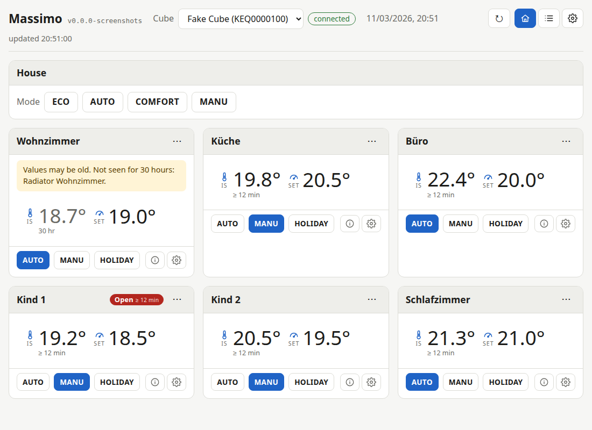
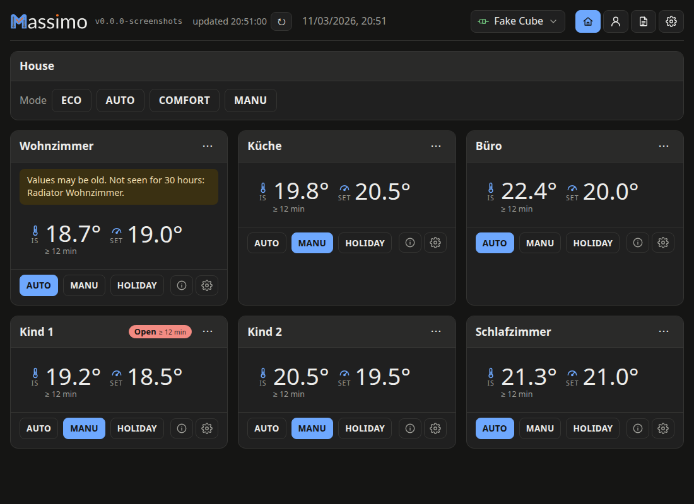
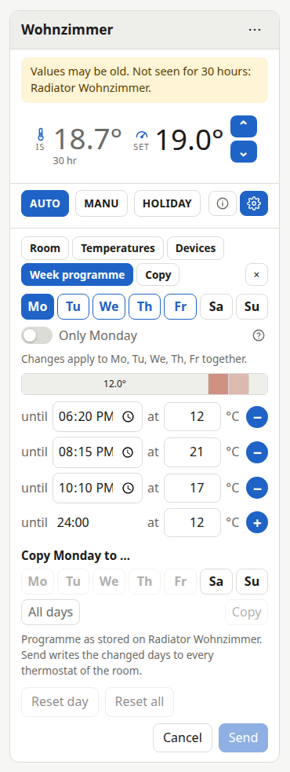
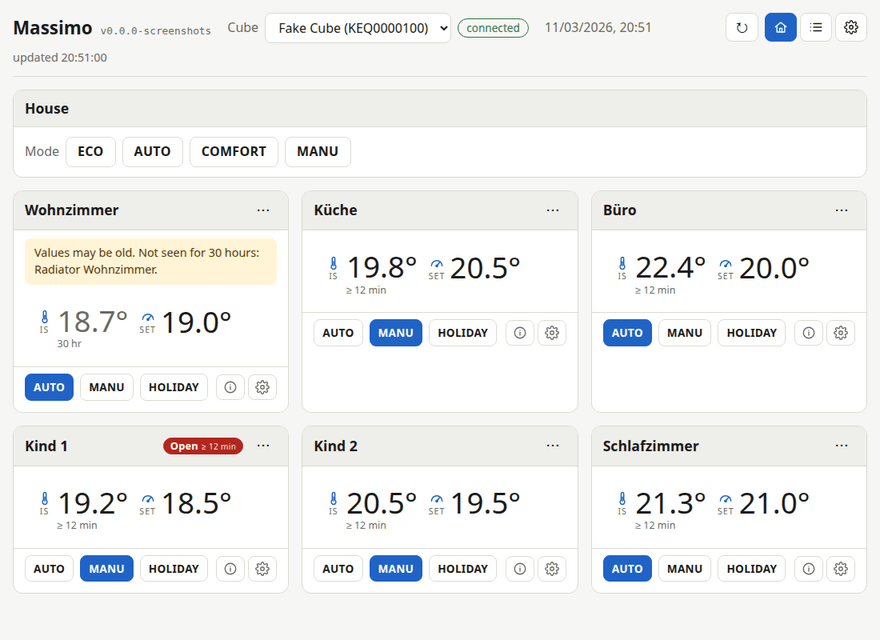

# Massimo

Open-source successor software for eQ-3 MAX! heating systems (MAX!
Cube LAN gateway, radiator and wall thermostats, window contacts,
eco switches) after the vendor's end of life.

Status: early development;
Phase 0 of [docs/design.md](docs/design.md) is done, Phase 1 in progress;
every release is a pre-release on the `alpha` channel (see [Versions](#versions)).

## Contents

- [Features](#features)
- [Documentation](#documentation)
- [Installing](#installing): [Linux](#linux), [Windows](#windows),
  [macOS](#macos)
- [Server](#server), with [Screenshots](#screenshots)
- [Command line](#command-line), with the [Cube variables](#cube-variables)
- [Original software](#original-software)
- [Versions](#versions)
- [Legal](#legal)

## Features



- **The web UI**:
  rooms as tiles with the measured and the set temperature, modes and setpoints,
  the House panel, the week programme editor, the device list and the log;
  light and dark, colour schemes of your own, six languages,
  phone and desktop ([docs/ui.md](docs/ui.md)).
- **A JSON API** with an OpenAPI description, live events and a bearer token
  ([docs/api-v1.md](docs/api-v1.md)).
- **Pairing** a new device from the web UI or the API,
  put into a room with the room's settings as the original software does,
  and a device removed from the Cube again ([docs/ui.md](docs/ui.md)).
- **Backup and restore** of a Cube's configuration as YAML or JSON,
  from the command line and the API.
- **The server as a Cube** for other clients, the original software included:
  one Cube, many clients ([docs/proxy.md](docs/proxy.md)).
- **Discovery and network configuration** of Cubes on the LAN.
- **The radio duty cycle respected**:
  a command queue per Cube, the Cube's budget in the log.
- **A service** on Linux (systemd), Windows and macOS,
  with signed updates from the web UI or `massimo update`.
- **The original software** run with a protocol log (`massimo legacy`).

Platforms: Linux on amd64 and ARM (a Raspberry Pi 1 is enough),
Windows 64-bit, macOS on Apple silicon and Intel;
the web UI in any current browser, on a phone or a desktop.

## Documentation

- [docs/api-v1.md](docs/api-v1.md),
  [docs/api-v1-openapi.yaml](docs/api-v1-openapi.yaml): the HTTP API
- [docs/ui.md](docs/ui.md): using the web UI
- [docs/proxy.md](docs/proxy.md): the server as a Cube for other clients
- [docs/portal-protocol.md](docs/portal-protocol.md):
  everything learned about the Cube, the portal and the radio commands
- [docs/firmware-extraction.md](docs/firmware-extraction.md):
  reading the Cube's firmware over JTAG, hardware facts and the procedure
- [docs/background.md](docs/background.md): the evaluation before the project,
  licence reasoning, routes to a public server, sources
- [docs/design.md](docs/design.md): the design proposal, target environments,
  phases and their status
- [docs/roadmap.md](docs/roadmap.md): what comes next, in order
- [docs/store.md](docs/store.md): the design of the server's persistent storage:
  engine, schema, users and roles, migration of installed boxes
- [docs/server.md](docs/server.md): the server mode: encryption at rest,
  the public server, sync, and what the store prepares for them
- [docs/handover-write-test.md](docs/handover-write-test.md):
  the test plan for the configuration writes on real hardware,
  [docs/write-test-2026-11-05.md](docs/write-test-2026-11-05.md) its results
- [docs/testing-windows.md](docs/testing-windows.md):
  the test plan for the Windows service on a real PC,
  [docs/windows-test-2026-11-05.md](docs/windows-test-2026-11-05.md) its results
- [docs/update-windows.md](docs/update-windows.md):
  the design for updates from the web UI on Windows: the options,
  the recommendation, the changes per file, the CI and real-PC tests
- [docs/handover-session.md](docs/handover-session.md):
  the context a session needs: how the project moves, where things run,
  the conventions, the checkout
- [docs/review-2026-11-05.md](docs/review-2026-11-05.md):
  code review with findings, extraction proposals and the coding standard
- [tools/ui-test/README.md](tools/ui-test/README.md): `make ui-test`,
  the web UI smoke test with Playwright, and its setup
- [docs/ui-testing.md](docs/ui-testing.md): testing the web UI:
  the smoke test, Cypress and Playwright compared, screenshots,
  the recommendation

## Installing

Massimo is one binary per platform with the web UI inside;
there is nothing else to install.
Every [release](https://github.com/metaworx/massimo/releases) carries the binaries below,
`SHA256SUMS` and the signed manifest that `massimo update` verifies.
Every release so far is a pre-release on the update channel `alpha` (see
[Versions](#versions)), which `releases/latest` skips,
so take the newest release from the page and put its tag in place of `<tag>` below.

| Asset | For |
|---|---|
| `massimo-linux-amd64` | PC or NAS with a 64-bit Linux |
| `massimo-linux-arm64` | Raspberry Pi 3, 4, 5 and Zero 2 W with a 64-bit OS (`uname -m` says `aarch64`) |
| `massimo-linux-armv7` | Raspberry Pi 2, 3, 4 and Zero 2 W with a 32-bit OS (`armv7l`) |
| `massimo-linux-armv6` | Raspberry Pi 1 (A, B, B+), Zero and Zero W (`armv6l`; the armv7 build dies there with "illegal instruction") |
| `massimo-windows-amd64.exe` | Windows PC, 64-bit |
| `massimo-darwin-arm64` | Mac with Apple silicon |
| `massimo-darwin-amd64` | Mac with an Intel processor |
| `massimo_<version>_<arch>.deb` | the Linux binary as a Debian package: `amd64`, `arm64`, `armhf` (every 32-bit Raspberry Pi OS), see [Linux](#linux) |

To build instead, with Go 1.26 or later installed:
`make` runs the tests and builds `./massimo` for this machine;
`make cross` builds every release binary into `dist/`,
one at a time with `make linux`, `make linux-arm64`, `make linux-armv7`,
`make linux-armv6`, `make darwin` (both Mac architectures) and `make windows`;
`make release` adds `SHA256SUMS` and the release manifest; `make vet`,
`make test` and `make clean` do what they say.
A build from `main` follows the channel `main`, which has no releases,
unless `MASSIMO_UPDATE_CHANNEL=alpha` is set,
see [packaging/README.md](packaging/README.md#updating).

`serve` reads its settings from the environment or from a `.env` in the
directory it is started from (see [Cube variables](#cube-variables)).
For a first run two lines are enough, the Cube's address (`massimo
discover` lists the Cubes on the LAN with serial and address) and the
token the API and the web UI then ask for:

```
MASSIMO_CUBE_KEQ0000000_ADDRESS=192.168.1.10
MASSIMO_API_TOKEN=choose-a-long-random-string
```

Each Cube accepts a single TCP client,
so close the original MAX! software and stop any other server before `serve` connects;
from then on they connect to the server's proxy instead of the Cube,
see [Server](#server).
The proxy needs TCP port 62910 and discovery UDP port 23272 open to the LAN,
and the API its port (8099 below) when it listens on a LAN address;
each subsection says what that means for the firewall.
WSL 2 in its default network mode has no LAN broadcast and takes no inbound LAN
connections, so a `serve` there can neither find Cubes nor answer as one,
and `massimo discover` finds nothing (mirrored networking mode on Windows 11 lifts that);
the service belongs on a Linux box or a Raspberry Pi,
a Windows PC or a Mac on the Cube's LAN.

### Linux

A Raspberry Pi is enough, a Pi 1 included
([resource use](packaging/README.md#resource-use));
[Preparing a Raspberry Pi 1](packaging/README.md#preparing-a-raspberry-pi-1)
sets one up without a screen.

**Try it.**
On the box, with the asset for it from the table (here the arm64 one):

```bash
curl -fLO https://github.com/metaworx/massimo/releases/download/<tag>/massimo-linux-arm64
curl -fLO https://github.com/metaworx/massimo/releases/download/<tag>/SHA256SUMS
sha256sum -c SHA256SUMS --ignore-missing
chmod +x massimo-linux-arm64
./massimo-linux-arm64 serve -listen 127.0.0.1:8099
```

with the `.env` from above in the same directory,
then open http://127.0.0.1:8099/ and enter the token;
`-listen :8099` serves the page to the LAN as well,
`-proxy off` leaves the proxy out for a first run.
A firewall on the box must allow incoming 62910/tcp and 23272/udp,
and 8099/tcp for the page on the LAN (with ufw:
`sudo ufw allow 62910/tcp && sudo ufw allow 23272/udp && sudo ufw allow 8099/tcp`).

**As a service.**
On a Linux with systemd, as root (`-dry-run` only shows what would be done):

```bash
sudo ./massimo-linux-arm64 install -dry-run -settings .env
sudo ./massimo-linux-arm64 install -settings .env
```

installs the binary as `/usr/local/bin/massimo`,
creates the system user `massimo`,
copies the `.env` to `/etc/massimo/env` (without `-settings` a commented
template to fill in, and the service is then not started),
writes `massimo.service`,
the update helper `massimo-update.path` and `.service` and the log rotation,
enables them and starts the service,
which listens on `:8099` on every interface.
It warns when `MASSIMO_API_TOKEN` is missing.
`-listen :80` moves the API and web UI to another address (kept by later installs),
`-no-update-helper` leaves the helper out,
and removes it where an earlier install put it,
`-no-start` only enables.
With several Cubes each needs its own `MASSIMO_CUBE_<SERIAL>_PROXY` address on the box,
see [Install by hand](packaging/README.md#install-by-hand).
Afterwards the settings are in `/etc/massimo/env` (readable by `massimo` only),
the state in `/var/lib/massimo`,
the log in `/var/log/massimo/serve.log` (rotated weekly) and in the journal:

```bash
sudo systemctl start massimo
sudo systemctl stop massimo
sudo systemctl status massimo
journalctl -u massimo -f                  # or: tail -f /var/log/massimo/serve.log
sudo massimo update -restart massimo.service -health http://127.0.0.1:8099/healthz
sudo massimo install -remove              # -purge: the settings, state, logs and user too
```

`update` installs the newest signed release of the channel and puts the old
binary back when the restarted server does not report the new version
(`-rollback` goes back by hand);
the button under Settings → Software in the web UI asks the helper to do the same,
which needs `MASSIMO_API_TOKEN`.
Running `install` again from a newer binary replaces the binary and the units
and keeps the settings.
Details: [Install with
`massimo install`](packaging/README.md#install-with-massimo-install),
[Moving to another network](packaging/README.md#moving-to-another-network),
[Updating](packaging/README.md#updating).

**As a package.**
On Debian, Ubuntu, Raspberry Pi OS or LoxBerry the release's `.deb` does the
same install through apt (`sudo apt install ./massimo_<version>_arm64.deb`;
`_armhf` for a 32-bit Raspberry Pi OS, the Pi 1 included, `_amd64` for a PC),
creates the user and `/etc/massimo/env` to fill in,
and owns the binary from then on:
the web UI and `massimo update` say when a release is out and apt installs it,
`apt purge massimo` removes everything.
The project's apt repository makes that an `apt upgrade`:
one suite per update channel, the snippet in
[The apt repository](packaging/README.md#the-apt-repository).
Details: [Debian package](packaging/README.md#debian-package).

### Windows

**Try it.**
In PowerShell, in a folder of your choice (`curl.exe` comes with Windows 10 and 11):

```powershell
curl.exe -fLO https://github.com/metaworx/massimo/releases/download/<tag>/massimo-windows-amd64.exe
curl.exe -fLO https://github.com/metaworx/massimo/releases/download/<tag>/SHA256SUMS
(Get-FileHash massimo-windows-amd64.exe -Algorithm SHA256).Hash.ToLower()
Select-String massimo-windows-amd64.exe SHA256SUMS
.\massimo-windows-amd64.exe serve -listen 127.0.0.1:8099
```

The two hashes must match.
With the `.env` from above in the same folder, open http://127.0.0.1:8099/.
The binary is not code-signed.
A download with `curl.exe` starts without a word;
one made with a browser carries the mark of the web,
and a double-click on it in Explorer meets SmartScreen's "Windows protected your
PC" dialog with "Unknown publisher"
([screenshot](docs/images/windows-smartscreen-unknown-publisher.png)):
"Run anyway" runs it, and starting it from a console shows no dialog at all.
The installed service and `massimo update` are not affected ([the test
report](docs/windows-test-2026-11-05.md), observation 8).
For the proxy and discovery,
Windows Defender Firewall must let the program receive on TCP 62910 and UDP
23272 on the private network (the installed service gets a rule for that,
a `serve` started by hand does not),
and the original MAX! software must not be running.

**As a service.**
In PowerShell opened with "Run as administrator", in that folder:

```powershell
.\massimo-windows-amd64.exe install -dry-run -settings .env
.\massimo-windows-amd64.exe install -settings .env
```

installs the binary as `C:\Program Files\Massimo\massimo.exe`,
the settings as `C:\ProgramData\Massimo\env` (without `-settings` a template to
fill in) with the logs `serve.log` and `service.log` next to them,
in a folder only SYSTEM and the Administrators can read,
the service `massimo` ("Massimo" in the Services console: automatic start,
LocalSystem, restarted after 10 s on failure, listening on `:8099`;
`-listen` changes that and later installs keep it) and the firewall rule
"Massimo" for the program on private and domain networks.
On a network Windows classes as public the rule does not apply and other devices
get no answer: `Get-NetConnectionProfile` shows the profile,
`Set-NetConnectionProfile` makes a home network private;
check it again after a reboot, which can match the network to another,
public profile.

```powershell
sc.exe start massimo
sc.exe stop massimo
sc.exe query massimo
Get-Content C:\ProgramData\Massimo\serve.log -Tail 20
.\massimo-windows-amd64.exe install -remove          # -purge: the settings and logs too
```

Details: [Windows](packaging/README.md#windows), and the test on a real
PC in [docs/windows-test-2026-11-05.md](docs/windows-test-2026-11-05.md).

**Update.**
An installed service is updated with the installed binary,
again in PowerShell opened with "Run as administrator":

```powershell
& "C:\Program Files\Massimo\massimo.exe" update -check
& "C:\Program Files\Massimo\massimo.exe" update -restart massimo -health http://127.0.0.1:8099/healthz
```

`-check` only says whether a newer signed release is out on the update channel.
Without it, `update` asks before replacing anything (`-yes` skips the question),
downloads the release's Windows binary and verifies it against the signed manifest,
test-runs it,
renames the running `C:\Program Files\Massimo\massimo.exe` to `massimo.exe.prev`,
puts the new one in its place,
and stops and starts the service `massimo` through the service manager.
With `-health` it then waits up to two minutes (`-health-timeout`) until
`/healthz` reports the new version,
and otherwise puts `massimo.exe.prev` back and keeps the failed binary as
`massimo.exe.failed`;
a binary that cannot run as a service is given up by the service manager after 30 s,
so that case ends after about 35 s.
With another `-listen` address give it in `-health`;
over `https://` the certificate is verified unless the host is the loopback
or one of the box's own addresses.
`-version <tag>` installs a given release, older ones too.

```powershell
& "C:\Program Files\Massimo\massimo.exe" update -rollback -restart massimo
Get-Content C:\ProgramData\Massimo\service.log -Tail 10
sc.exe query massimo
```

`-rollback` swaps `massimo.exe` and `massimo.exe.prev` back and restarts the
service (once more goes forward again).
The result is in the command's own output,
in `C:\ProgramData\Massimo\service.log` ("stop requested", "serve stopped",
"stopped", "started as a service", "running",
and any error that ended `serve`), and,
for the service manager's view,
in
`Get-WinEvent -FilterHashtable @{LogName='System'; ProviderName='Service Control Manager'} -MaxEvents 10`.
Running `install` again from a newer downloaded binary also replaces the binary
and keeps the settings.
The Update button under Settings → Software works as on Linux (with
`MASSIMO_API_TOKEN` set): the server starts the same `update` in the background,
which stops and starts the service,
rolls back when the new version does not come up,
and logs to `C:\ProgramData\Massimo\update.log`
([docs/update-windows.md](docs/update-windows.md)).
Details: [Windows](packaging/README.md#windows)
and [Updating](packaging/README.md#updating) in packaging/README.md.

### macOS

**Try it.**
In Terminal, with `massimo-darwin-arm64` on Apple silicon
or `massimo-darwin-amd64` on an Intel Mac:

```sh
curl -fLO https://github.com/metaworx/massimo/releases/download/<tag>/massimo-darwin-arm64
curl -fLO https://github.com/metaworx/massimo/releases/download/<tag>/SHA256SUMS
shasum -a 256 massimo-darwin-arm64 && grep massimo-darwin-arm64 SHA256SUMS
chmod +x massimo-darwin-arm64
./massimo-darwin-arm64 serve -listen 127.0.0.1:8099
```

The two hashes must match.
With the `.env` from above in the same folder, open http://127.0.0.1:8099/.
The binaries are ad-hoc signed, not notarized:
a download with `curl` runs as it is,
one through a browser carries the quarantine attribute and Gatekeeper refuses it
until `xattr -d com.apple.quarantine massimo-darwin-arm64`.
With the application firewall on,
the binary must be allowed to accept incoming connections for the proxy
and discovery (install does that for the service).

**As a service.**
As root, in that folder:

```sh
sudo ./massimo-darwin-arm64 install -dry-run -settings .env
sudo ./massimo-darwin-arm64 install -settings .env
```

installs the Linux layout: the binary `/usr/local/bin/massimo`,
the hidden user `_massimo`,
the settings `/etc/massimo/env` (without `-settings` a template to fill in),
the state `/var/lib/massimo`,
the log `/var/log/massimo/serve.log` (launchd appends to it; it is not rotated),
and in `/Library/LaunchDaemons` the daemon `ch.metaworx.massimo` (started at
boot without a login, restarted 10 s after a failure, listening on `:8099`;
`-listen` changes that and later installs keep it) and the update helper
`ch.metaworx.massimo-update`.
With the application firewall on, install allows the binary.
Control it with `launchctl`, all with `sudo`:

```sh
launchctl print system/ch.metaworx.massimo                                   # state, PID, last exit
launchctl kickstart -k system/ch.metaworx.massimo                            # restart
launchctl bootout system/ch.metaworx.massimo                                 # stop until the next boot
launchctl bootstrap system /Library/LaunchDaemons/ch.metaworx.massimo.plist  # start again
tail -f /var/log/massimo/serve.log
massimo update -restart ch.metaworx.massimo -health http://127.0.0.1:8099/healthz
massimo install -remove                                                      # -purge: the settings, state, logs and user too
```

The button under Settings → Software in the web UI works as on Linux,
through the helper (its log is `/var/log/massimo-update.log`).
Details: [macOS](packaging/README.md#macos).

**With Homebrew.**
`brew install metaworx/massimo/massimo-alpha` builds the release from source
(nothing needs notarization), `brew services start massimo-alpha` runs it as you
(`sudo` for a daemon at boot),
and the settings are in `$(brew --prefix)/etc/massimo/env`;
brew then owns the binary and `brew upgrade` updates it,
while the web UI and `massimo update` say when a release is out.
Details: [Homebrew](packaging/README.md#homebrew).

## Server

```bash
massimo serve -listen 127.0.0.1:8099
```

keeps every Cube from the environment connected (one connection and one command
queue per Cube) and serves a JSON API: `/api/v1/cubes`,
`/api/v1/cubes/{serial}` (with rooms;
`PUT` and `DELETE` change and remove the Cube, `POST /api/v1/cubes` adds one),
`/api/v1/settings` (the stale threshold, the intervals and the retentions),
`/devices`, `/devices/{rf}`,
`PUT …/devices/{rf}/setpoint` and `PUT …/rooms/{id}/setpoint` with
`{"mode":"manual","temp":21.5}`,
`{"mode":"auto"}` or `{"mode":"vacation","temp":17,"until":"2026-11-10 12:00"}`,
`PUT …/devices/{rf}/lock` with `{"locked":false}` for the key lock,
`/backup?format=yaml`,
`POST …/restore/plan` and `POST …/restore` to restore a backup the way
`massimo restore` does (plan first, then send;
`GET …/restore` for the progress), and `/events` as server-sent events;
see [docs/api-v1.md](docs/api-v1.md) and the OpenAPI description in
[docs/api-v1-openapi.yaml](docs/api-v1-openapi.yaml).
Who may do what: users with roles in the store, each request carrying a
session from `POST /api/v1/login` or an API key as `Authorization: Bearer`,
the role granting the capabilities a route needs (setpoints, configuration,
pairing, users, …) and `GET /api/v1/me` saying which;
the audit (`GET /api/v1/audit`) records every request that changes something
and the commands (`GET /api/v1/commands/{id}`) its steps on the Cube's queue,
with `Idempotency-Key` answering a retry without a second radio command.
`MASSIMO_API_TOKEN` (or `-token`) becomes the owner's key at the first start,
and is the one token without a store (`serve -addr`);
while there are no users the API is open to the local network only,
and the first owner is created with `massimo user add` or by the web UI from
the local network.
See docs/api-v1.md, "Authentication".
The web UI's settings and colour schemes follow a signed-in user with the
capability `preferences` to every browser (`/api/v1/me/preferences`),
each with a switch to keep it on one device; a guest's stay in its browser.
A web UI, plain HTML and JavaScript embedded in the binary,
is served at http://127.0.0.1:8099/ :
one tile per room with the measured and the set temperature with a thermometer
and a gauge icon, up/down chevrons that send two seconds after the last click,
AUTO,
MANU and HOLIDAY plus an info and a cog button for the device list and the configuration,
a House tile whose ECO, AUTO,
COMFORT and MANU open a one-screen panel with mode, duration and room selection,
vacation per room inline, the device list with coloured mode badges,
offsets and locks, live updates plus polling with a refresh button,
the Cube clock in the browser's or the Cube's time zone,
and a settings page with an Expert switch for the technical details, Rooms,
Log and Settings as icon buttons at the right of the header,
a per-room configuration area (name, temperatures, boost and descaling,
device names and offsets, moves,
the week programme with a day editor that edits the days sharing a programme together,
copy of rooms' settings to other rooms), a help button next to every setting,
and a log view of the Cube's events.
The page speaks English, German, French, Italian,
Dutch and Polish (from the browser, or chosen in the settings),
from the translation files in `internal/server/ui/i18n/`, one per language.
[docs/ui.md](docs/ui.md) describes how to use it.
It is meant for the LAN.
The listener defaults to localhost and plain HTTP.
`-tls files -tls-cert <pem> -tls-key <pem>` (or `MASSIMO_TLS_CERT`
and `MASSIMO_TLS_KEY` in the settings) serves the API and the UI over TLS from
any certificate,
the chain after the server's certificate as every ACME client writes it;
the files are re-read when they change,
so a renewal by certbot or acme.sh needs no restart,
only a deploy hook that copies the files where the service user can read them
(`massimo install -tls-cert … -tls-key …` does that once,
see [packaging/README.md](packaging/README.md)).
`-tls self-signed` needs no certificate:
the server makes one at its first start for the box's names (its hostname,
`<hostname>.local`, `localhost`, its addresses,
and `-tls-names` for a name you gave it) into the data directory's `tls/`,
valid 825 days and renewed 30 days before the end with the names it has;
every browser warns once per device,
and the fingerprint to compare is in the log, in `massimo config`,
in `massimo tls show`, in `/healthz` and under the page's header.
A box whose address changed gets a new one with `massimo tls self-signed`,
which a running server takes up at once.
`-tls acme -tls-names <name>` gets a certificate from Let's Encrypt for a
DNS name that resolves to the box, and renews it by itself:
the validation reaches the box on port 443 (a router forwards its public
443 to the server's port; the name's record is the public address,
dynamic DNS where it changes), by TLS-ALPN-01 on the listener itself,
or with `-tls-http :80` by HTTP-01 on a plain port 80 as well,
which then redirects to `https://`.
`-acme-email` gives the account a contact address;
the account key and the certificates live in the data directory's `tls/acme/`.
A client that names no host, as one does for an address (`https://127.0.0.1`,
the update helper's health check among them),
gets the certificate of the first name.
Let's Encrypt allows five failed orders an hour per name,
so experiments use its staging directory
(`-acme-directory https://acme-staging-v02.api.letsencrypt.org/directory`).
`-acme-dns-hook <script>` takes the DNS-01 challenge instead:
the server asks the script to set and clear a TXT record under `_acme-challenge.<name>`,
so no port has to be open, the name may point at the box's LAN address,
and wildcards (`-tls-names '*.example.net,example.net'`) work;
`packaging/acme-dns-hooks/infomaniak.sh` is the script for a zone at Infomaniak,
and any other provider's API fits in a dozen lines (see
[packaging/README.md](packaging/README.md)).
A certificate that ends within two weeks, or an order that has not succeeded,
is a warning in the log, in `/healthz` and under the page's header.
With TLS the server tells browsers to use `https://` for its host for a year
(`-hsts <days>`);
a browser that saw that refuses `http://` until the days are up,
so before switching TLS off, run the server once with `-hsts 0` over TLS,
which clears it.
A reverse proxy with TLS in front works as before and sets its own HSTS;
the UI needs the same token as the API either way.
`-trusted-proxies <addresses or CIDRs>` tells the server which peers'
`X-Forwarded-For` to believe,
so the lockout and the first-owner form see the real client,
and the page works under a path prefix such as `/massimo/`
([docs/reverse-proxy.md](docs/reverse-proxy.md), with nginx and Caddy samples).
`-log <file>` (or `MASSIMO_LOG`) appends the log,
including every device state change, to a file as well.
`-log-level debug` (or `MASSIMO_LOG_LEVEL`; `info`, the default,
`warn` and `error`) adds the Debug lines,
such as every failed attempt to reach a lost Cube
and every command the proxy passes on to it;
the level is read at the start,
and a change in the settings file waits for the next restart, as listed below.
Every other command takes `-log-level` before its name,
`massimo -log-level debug watch`.
A restart from the API (`POST /api/v1/restart`, for the capability `restart`)
stops the server as SIGTERM does and exits with status 75,
which systemd, launchd and Homebrew answer with a start;
a Windows service runs `massimo restart` instead,
which stops and starts the service through the service manager.
`-restart` (or `MASSIMO_RESTART`) says when it is offered:
`auto` where a service manager starts the server again, so not in a terminal;
`exit` always, exiting 75 for whatever runs `serve`,
such as Docker's `--restart`;
`off` never.
`sudo massimo restart` restarts the installed server from a prompt as well.
`serve` reads its settings file again while it runs:
it looks at it every five seconds,
and reads it once a change has held for one more look,
and on Unix also on SIGHUP (`systemctl reload massimo`),
which checkpoints the store too.
`MASSIMO_API_TOKEN` applies at once, as at a start, unless `-token` was given;
every other setting that changed is listed by `GET /api/v1/restart`
as applying at the next restart.
`-sighup` (or `MASSIMO_SIGHUP`) says what SIGHUP does:
`reload`, `stop` as SIGTERM does,
or `auto`, a reload under a service manager or after `nohup`,
and a stop in a terminal, where SIGHUP means that the terminal closed.
Every six hours (`-refresh`,
`0` to switch it off) `serve` reconnects to each Cube,
in turn with the queued commands, and re-reads everything the Cube holds,
so a write the Cube acknowledged but did not apply cannot leave the server's
copy wrong for long.
After a configuration write it reads the device's configuration again for about
six minutes until the device has taken it,
and after radio writes it reconnects once for the Cube's budget if radiograms
were pending, at most every 15 minutes (only while `-refresh` is on).
Writes that a client of the proxy (below) sends,
such as the original software's, are followed up the same way.
The log lists every wakeup and every radio command the Cube accepted,
with its duty cycle and free slots.

The Cube serves only one LAN client at a time,
so `serve` is itself a Cube for everyone else:
it listens on port 62910 on every interface (`-proxy <addr>[:<port>]`,
repeatable, `-proxy off` to disable) and answers UDP discovery.
Every other massimo command and the original software connect to the host
running `serve` (`-addr <serve host>`) and work beside it:
reads are answered from the server's copy,
writes go through its queue to the Cube.
The original software keeps only one discovery answer per serial,
and the real Cube answers first,
so give the server a different serial for discovery with `-proxy-serial`,
for example the real one with the first letter changed,
or block the Cube's UDP answers on the PC's firewall.
See [docs/proxy.md](docs/proxy.md).

### Screenshots

The web UI against the fake Cube, light and dark,
and a room's tile with its week programme:






The whole set is in [docs/screenshots/](docs/screenshots/),
taken by `make ui-screenshots` (tools/ui-test/README.md),
and as a slideshow:



## Command line

`massimo help` lists the commands; the ones useful today:

```bash
massimo backup -addr <cube-ip> [-out backup.yaml]
```

saves rooms, device names, thermostat settings, week programs, NTP servers
and time zone rules, together with the raw protocol lines, as JSON or YAML.

```bash
massimo restore -addr <cube-ip> -from backup.yaml -dry-run
```

compares a backup (which may be edited by hand) with the Cube and shows what
would be written;
without `-dry-run` it asks and then sends only the differences,
respecting the radio duty cycle.
Each device's live state (mode, setpoint, measured temperature,
valve) is in the file for information;
`-state` re-applies mode and setpoint too.
Pairing cannot be restored over the LAN:
devices missing from the Cube are listed,
and the restore can be repeated after they have been paired again.

```bash
massimo status
massimo watch -addr <cube-ip>
massimo fakecube -greeting internal/protocol/cube/testdata/cube-fw0113-greeting.txt
```

`status` lists every device the Cube knows, grouped by room,
with its last state and whether the Cube holds state for it at all:
after a Cube restart every device is "not reported" until it transmits again,
window contacts only on a window change,
and the Cube discards room commands while a room has such a member,
so the room is marked not ready (`-json` for machines).
`watch` prints state changes as they happen;
`fakecube` serves recorded data on port 62910 so everything can be tried without hardware,
and with `-discovery 127.0.0.1:23273` it also answers UDP discovery as a further
Cube (`-discovery-serial`),
which `serve -discover-target 127.0.0.1:23273` finds.
`-pair 1514b6,0abcde,TEQ0000001` adds a device that joins pairing mode two seconds
after `n:`, a copy of the greeting's 1514b6 as 0abcde in no room,
and joins again after it was removed (a fourth field sets the delay).

```bash
massimo discover
massimo portal-crypto iv -addr <cube-ip>
```

```bash
massimo portal -listen :80 -probe default -probe-target 1514b6:6 -probe-cube 192.168.1.46
```

Probe mode answers each poll with the next reply variant (an `s:` radio
command in different forms) and judges it by the Cube's free memory
slots in the following poll: an accepted radio command occupies a slot.
With `-probe-cube` the portal sends `i:` over the LAN after each reply so the
next poll comes within seconds.
`-probe <file>` takes custom variants,
one `name=text` per line with `\r\n` escapes and the placeholders `{i}`, `{s}`,
`{shex}`, `{r}`, `{serial}`, `{rf}`, `{fw}`.

`discover` lists the Cubes on the LAN (serial, IP, MAC, RF address, firmware,
and whether the Cube takes its address by DHCP or has a static one) via the UDP
broadcast the original software uses;
it needs UDP port 23272 and a real LAN interface (not WSL 2).
`portal-crypto iv` recovers a Cube's portal IV from one `e:` exchange.

```bash
massimo netconfig -addr <cube-ip>
massimo netconfig -addr <cube-ip> -static <ip> -gateway <gw> -netmask <mask> [-dns <a>[,<b>]]
massimo netconfig -addr <cube-ip> -dhcp
massimo netconfig -sn <serial> -broadcast -dhcp
```

`netconfig` reads a Cube's network configuration over UDP 23272 (`-json` too):
the addresses in use, and the stored static configuration,
which with DHCP on is only the fallback.
It writes a static address with DHCP off, or DHCP on.
A write shows the current and the new values and asks first (`-yes` skips that),
checks that the ip and the gateway lie in the netmask's subnet,
keeps the Cube's encryption flag as read,
and re-reads the result after the Cube's restart (a static address applies at
once and is followed by a restart, as the original software does;
DHCP makes the Cube restart by itself);
`-dry-run` prints the frame and sends nothing.
A wrong configuration strands the Cube on an address nothing can reach.
The way back is `netconfig -sn <serial> -broadcast -dhcp`,
broadcasts that only the Cube with that serial takes:
it reads the stored configuration first and changes only the DHCP flag, or,
when the read gets no answer, sends zeros for the addresses,
which loses the stored fallback (192.168.0.222/16 from the factory) without restoring it;
a Cube that moved networks may need a power cycle.

### Cube variables

The Cubes are configured in the environment or in `.env` in the current
directory (`KEY=VALUE` lines,
`-env <file>` or `MASSIMO_ENV_FILE` for another file;
the environment wins over the file).
Keep the file out of git; `massimo config` shows what is in effect,
secrets redacted.

`serve` keeps the Cubes in its own store instead,
`massimo.db` in the data directory (`-data <dir>` before the command name,
or `MASSIMO_DATA`; else the current directory,
so a terminal run puts it next to `.env`;
the installed services pass the state directory,
see [packaging/README.md](packaging/README.md#the-store)).
At every start `serve` adds to the store each Cube of the file it does not know yet,
logged as `cube added from the settings file`;
that is how the first start after the update takes the file over,
and how a Cube added to the file by hand later is still picked up.
From then on the store wins for that Cube: `_ADDRESS`, `_NAME`, `_PROXY`,
`_PROXY_SERIAL` and `_IGNORE` are read from the store,
and a line of the file that differs is logged at the start
(`settings file differs from the store, the store wins`,
with both values) and shown on the Cube in `GET /api/v1/cubes` (`file_differs`)
and under Settings → Cubes in the web UI, which offers the file's value.
That page, and `POST /api/v1/cubes`, `PUT` and `DELETE /api/v1/cubes/{serial}`,
add a Cube, change its name, address, proxy and hidden devices,
and remove it while `serve` runs.
`massimo config` prints, per Cube,
which value is the store's and which line of the file differs.
The keys and IVs, `MASSIMO_API_TOKEN`, `MASSIMO_LISTEN`,
`MASSIMO_LOG`, `MASSIMO_LOG_LEVEL`,
the TLS and update variables and `MASSIMO_CUBE_SN` stay in the file only,
and every command other than `serve` keeps reading all of its lines as before.
`-addr` and `-sn` still pick a Cube for one run and write nothing for it;
`serve -addr` runs without the store altogether (no `massimo.db` is opened or created,
found Cubes are not kept).
`massimo store backup <file>` writes a consistent copy of the store,
also while `serve` runs (copying `massimo.db` alone can miss the last writes,
which are in `massimo.db-wal` until a checkpoint,
at the latest at a clean stop),
`store migrate` creates or migrates it without starting `serve`,
and `store info` prints its schema version, node and row counts;
for the service run them as its user,
for example `sudo -u massimo massimo -data /var/lib/massimo store info`.

`massimo user` manages the users of the store from the box (docs/api-v1.md,
"Authentication"):
`user add <name> -role operator` asks for the password twice (`-no-password` for
a user with keys only,
`-password-stdin` to read it from standard input for scripts,
`-expires <RFC 3339>` for a guest's end), `user list`, `user passwd <name>`,
`user disable <name>` and `user enable <name>`,
`user token <name> -label Loxone` prints a new API key once,
`user tokens <name>` lists the user's sessions and keys with their ids,
and `user revoke <name> [<token id>]` revokes one token or every one.
It opens the store beside a running `serve`;
for the service run it as its user,
for example `sudo -u massimo massimo -data /var/lib/massimo user add anna -role operator`.
The audit records what it did with the remote `cli`.
With `MASSIMO_API_TOKEN` set, the first start of `serve` creates the user
`owner` with the token as its API key, so the token keeps working;
without it, the first owner is created with `user add <name> -role owner`
or with the form the web UI offers on the local network while there are no users.

Every variable has a per-Cube form with the serial in it,
`MASSIMO_CUBE_<SERIAL>_KEY` for `MASSIMO_CUBE_KEY`, which wins for that Cube;
the plain form applies to any Cube unless the table says otherwise.

| Variable (per-Cube form) | Meaning |
|---|---|
| `MASSIMO_CUBE_<SERIAL>_ADDRESS` | The Cube's address, host[:port]. `serve` serves every Cube that has one. |
| `MASSIMO_CUBE_<SERIAL>_KEY` | The Cube's key from its QR code (`k` and 32 hex digits), for the portal commands. |
| `MASSIMO_CUBE_<SERIAL>_IV` | The Cube's portal IV, recovered with `portal-crypto iv`. `portal` serves every Cube that has a key and an IV. |
| `MASSIMO_CUBE_<SERIAL>_PROXY` | The address of a running `massimo serve` that answers as this Cube. Every command except `serve` connects to it instead of the Cube, because the Cube serves one client at a time and `serve` usually holds that connection; `serve` listens on it. When the proxy does not answer within two seconds, the command prints a warning and connects to the Cube's own address: during the few seconds `serve` restarts, for example after an update, that direct connection takes the Cube's only slot and keeps `serve` from reconnecting until the command ends. Before the command name, `-no-direct` (`massimo -no-direct status`, for scripts) makes that an error instead, and `-direct` skips the proxy and connects to the Cube itself even when the proxy answers; the two exclude each other, and `-addr` always wins. The plain form only with a single Cube. |
| `MASSIMO_CUBE_<SERIAL>_PROXY_SERIAL` | The serial `serve` uses in UDP discovery replies for this Cube, see [docs/proxy.md](docs/proxy.md). The plain form only with a single Cube. |
| `MASSIMO_CUBE_<SERIAL>_IGNORE` | Radio addresses to hide, comma separated, in addition to room 255 (below). |
| `MASSIMO_CUBE_<SERIAL>_NAME` | A user-friendly name the API and the UI show next to the serial. The plain form only with a single Cube. |
| `MASSIMO_CUBE_SN` | The Cube to use when no `-sn` is given. |
| `MASSIMO_DATA` | The data directory, where `serve` keeps `massimo.db` (also `-data <dir>` before the command name); default the current directory. |

`-sn <serial>` selects a Cube:
every command then reads that Cube's variables and, without an address,
discovers the Cube on the LAN; with `-addr` instead,
the serial the Cube reports selects them.
`-addr` always wins over the variables.
`serve -sn <serial>` serves that one Cube instead of every configured one.

`serve` serves every Cube its store has as configured.
From the file it takes over every Cube with an `_ADDRESS`, and also, by serial,
every Cube with a `_NAME` or a `_PROXY` but no `_ADDRESS`;
the one given with `-sn` or `MASSIMO_CUBE_SN` is served for the run when nothing
else is configured.
A Cube without an address is connected at the address it answers UDP discovery from,
and reconnected when that changes.
A key alone does not make `serve` take a Cube.
A lone `MASSIMO_CUBE_ADDRESS` without a serial is served from the file until the
Cube reports its serial, and then added to the store.
Beside the variables of one Cube, such as its `_PROXY`,
the plain `MASSIMO_CUBE_ADDRESS` is that Cube's when `MASSIMO_CUBE_SN` names it,
as for the other commands.
`serve` runs discovery at the start and every 30 minutes (`-discover-interval`,
`0` for only on request through the API,
`-discover-target <host>` to ask given addresses instead of broadcasting),
lists Cubes it finds that are not configured in the API (`GET /api/v1/cubes`
with `"configured": false`),
keeps them in the store so that they are still listed after a restart,
and logs a configured Cube that answers from another address than configured.
`-poll`, `-refresh` and `-discover-interval` win for one run over the store's
settings `poll_interval`, `refresh_interval` and `discover_interval`.

Room 255 is the room for hidden devices:
a device that is paired but never reports blocks every command to the room the
Cube counts it in, and the Cube never drops it,
so the way out is to park it in room 255 on the Cube (edit a backup and restore it,
see docs/portal-protocol.md).
Every massimo command,
the API and the proxy then hide that room and its devices without any configuration,
so `status` on another computer and the original software do not see them either,
and `restore` keeps them exactly as the Cube has them.
The devices in `MASSIMO_CUBE_<SERIAL>_IGNORE` (for `serve`,
the Cube's hidden list in the store) are hidden in the same way.
`-show-hidden` before the command name (`serve -show-hidden` for the server;
`-show-ghosts` and `-no-ignore` are older names) shows and touches them for one run,
for example to move a device out again.

## Original software

```bash
massimo legacy -out max-session.log
```

starts the original MAX! software (Java 8, installation directory
`C:\ProgramData\MAX` by default, `-dir` otherwise) and prints only the
protocol-relevant lines: API and gateway calls, radiograms, send results,
and the Cube search (the interfaces it binds to, the adapters it tries,
how many gateways it found).
The software never prints the LAN lines it writes, not even at debug level,
so `legacy` reconstructs them from the logged gateway calls (`s:`, `t:`, `m:`,
`z:`, `c:`, `l:`, `n:`, `x:`, `q:`) and prints each beneath its call,
marked `lan (derived)`.
`-out` saves the complete output, `-all` shows it, `-width` shortens long lines.
With `serve` running, point the software at the serve host rather than the Cube:
in its Cube list pick the entry with the serve host's address (started with
`-proxy-serial`, it appears under that serial).

## Versions

Development happens on `main`.
`make release-alpha` promotes `main` to the branch `alpha` and tags it as the
next pre-release, which the release workflow builds, signs and publishes.
Everything below `v1.0.0`, and every version with a suffix (`-alpha.N`,
`-beta.N`, …), is a pre-release;
only a plain `vX.Y.Z` from `v1.0.0` on is stable.
Below `v1.0.0` a minor release may break things.
A new feature or breaking change starts the next minor
(`make release-alpha BUMP=minor` gives `v0.2.0-alpha.1`),
a fix or another round counts the suffix up (`v0.2.0-alpha.2`);
the suffix names the channel,
so promoting to a later `beta` branch tags `-beta.N`.

A release is made on `main`, checked out, clean and equal to `origin/main`.
`make release-alpha` cuts `CHANGELOG.md`'s `[Unreleased]` into the release's
section with `GUIDELINES/shared/tools/changelog.sh`,
commits it on `main` as `chore(release): vX.Y.Z-alpha.N`, and tags that commit,
signed, with the section as the tag's message,
so the tag carries the release notes, and the GitHub release shows them.
It then pushes `main`, `alpha` and the tag together or not at all.
It refuses when `alpha` has commits `main` lacks,
when `main`'s head is released already,
when `changelog.sh check` finds something,
and when `[Unreleased]` holds no bullet.
`make release-alpha DRY=1` shows what it would cut, tag and push,
and does none of it;
`ASSISTED_BY=agent:model` gives an agent's release commit its `Assisted-by` trailer.

Boxes following the update channel `alpha` get each release from `massimo
update` or the web UI (see [packaging/README.md](packaging/README.md#updating)).
`make` builds carry the version from `git describe`, `go run` builds
report the commit only with `go run -buildvcs=true`.

## Legal

Licensed under the [GNU Affero General Public License v3.0 or later](LICENSE).

"MAX!" and "eQ-3" are trademarks of eQ-3 AG.
This project is not affiliated with or endorsed by eQ-3.
